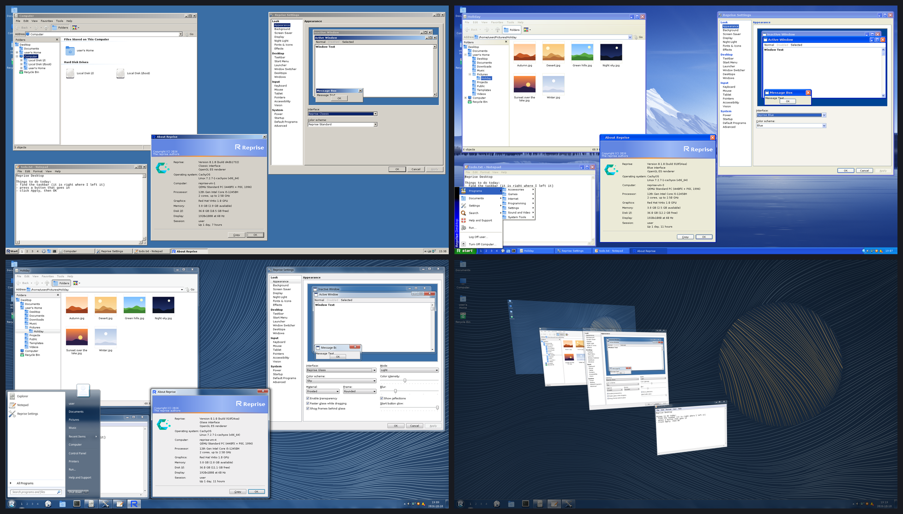

<h1>
  <picture>
    <source media="(prefers-color-scheme: dark)" srcset="docs/logo/reprise-lockup-white.svg">
    
  </picture>
</h1>

A Linux desktop for people who miss grey buttons and would like the computer
to stop making suggestions.

More in the [showcase](docs/showcase.md).

I wanted my taskbar back. This got out of hand.

Reprise is a Wayland desktop from back when computers were fun to use. It
comes in three looks, and you can switch between them without logging out:

- **Reprise Classic.** Grey bevels, navy title bars, and buttons that go in
  when you press them. Thirty-two colour schemes, from Brick to Tokyo Night,
  because even nostalgia deserves a dark mode.
- **Reprise Blue.** Glossy caption buttons, a rounded Start button and a
  taskbar with a gradient on it. Eight schemes, from Blue to Cobalt. The
  computer looks like it's about to tell you it's ready to use.
- **Reprise Glass.** Translucent frames over a blur of whatever's behind
  them, a Start orb, window shadows, a 3D window switcher and a dark mode.
  Finally, windows you can actually see through.

You can tell which window has focus. You can tell what's clickable. The
scrollbar is still there, even when you're not looking directly at it.
Apparently these are features now.

There's some selective memory involved. Reprise also has a searchable
launcher, snap layouts, clipboard history, screen sharing, fractional scaling
and support for hardware made this decade. I miss the desktop, not the
afternoon spent getting a sound card to work.

## Why

At some point, everyone agreed that buttons were embarrassing and should
disguise themselves as text. Scrollbars went into hiding. Settings got
rearranged again. A perfectly good rectangle became an invitation to explore.

I liked the rectangles.

The old desktops had their faults, but you could usually work out what to do
by looking at them. Buttons had edges. Dialogs had OK, Cancel and Apply.
Right-click gave you a menu. You could learn where things were and reasonably
expect them to be there next week.

That's the desktop I want to use, so that's what I'm building. Three times,
apparently.

## What you get

- **A real taskbar.** Start menu, Quick Launch, a tray, and a clock that
  shows the month when you click it. Put it on any edge of the screen, hide
  it, pin programs to it, group them or don't. It's your taskbar.
- **Windows you can find.** Alt+Tab with live pictures, a window overview,
  virtual desktops, window tabs, and snap layouts that drop down when you
  drag a window toward the top of the screen.
- **Programs that match.** Explorer, Notepad, Volume Control, Printers,
  Network Connections, Power Options, Bluetooth, User Accounts, Software
  Updates and a 23-page Reprise Settings. Having built all those property
  sheets, I do expect someone to use them.
- **The good bits of this century.** A launcher that does sums, clipboard
  history, an emoji picker, notification history with Do Not Disturb, night
  light, a magnifier, colour filters and screen reader support.
- **A modern Linux underneath.** PipeWire, NetworkManager, BlueZ, UPower,
  systemd-logind and the desktop portals. Screen sharing works in your
  browser, Flatpaks ask before they get anything, and GTK, Qt and X11
  programs run alongside the built-in ones.
- **About boxes** that report your memory in kilobytes, with thousands
  separators. You paid for all that RAM. You should get a long number.

Nothing installs, syncs or recommends itself without asking. There is no news
feed in the Start menu, and there never will be.

The long version: [every feature](docs/features.md), [the three
interfaces](docs/interfaces.md) and [the bundled programs](docs/programs.md).

## Try it

Install the [requirements](docs/install.md#requirements), then:

    cargo build --release
    ./target/release/reprise --startup alacritty   # nested in your current Wayland session

On Arch, `packaging/arch/PKGBUILD` packages the whole thing. Once it's
installed, pick "Reprise" in your login manager. [docs/install.md](docs/install.md)
has the details.

Reprise reads `~/.config/reprise/config.toml` and applies an edit the moment
you save. Most of it is also in Reprise Settings, which writes your changes
back without eating your comments. See
[docs/configuration.md](docs/configuration.md).

## Docs

- [Showcase](docs/showcase.md): what it looks like
- [Features](docs/features.md): the full list
- [Interfaces](docs/interfaces.md): Classic, Blue and Glass, their colour
  schemes and what each one turns on
- [Programs](docs/programs.md): Explorer, Notepad, Reprise Settings and the
  rest
- [Configuration](docs/configuration.md): the main sections of the config
  file
- [Install](docs/install.md): requirements, building, packaging
- [Protocols and portals](docs/protocols.md): for the panels, lockers and
  pagers you might want to bolt on
- [reprisekit](docs/reprisekit.md): build your own period-correct apps
- [Clipboard access for Flatpak apps](docs/flatpak-clipboard.md)
- [Assets](docs/assets.md): fonts, icons and what Reprise leaves out on purpose
- [Contributing](CONTRIBUTING.md): building, tests and how the code is laid
  out
- [Security](SECURITY.md): how to report a vulnerability privately

## Status

Early. I use it as my daily desktop. Please take that as a statement about my
tolerance for inconvenience, not a stability guarantee.

Expect rough edges, greyed-out menu items waiting for an implementation, and
the occasional pixel I haven't noticed yet.

## Made with AI

AI coding agents wrote most of the code. I decide what to build, how it
should look and behave, and whether it's done. The agents do most of the
typing, including the tests that check whether a button's bevel is right.

If that puts you off, fair enough. I'd rather you knew before installing it.

There is something funny about using all this technology to get back to a
grey property sheet with an Apply button. There is also a bug tracker.
If something breaks, open an issue.

## License and assets

Reprise's source code is licensed under the
[GNU General Public License v3.0 or later](LICENSE).

Fonts, icons and other third-party assets retain their own licenses. See
[docs/assets.md](docs/assets.md) for sources, licenses and installation details.

Reprise is an independent project and is not affiliated with or endorsed by
Microsoft.
