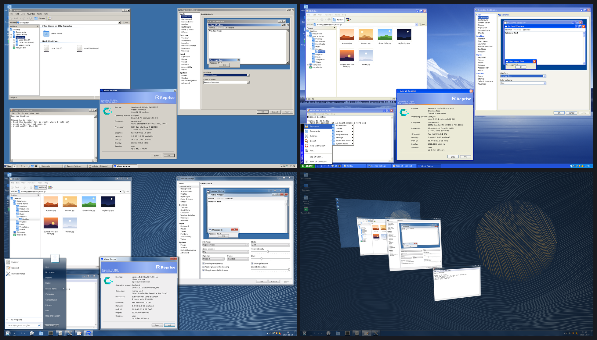

<h1>
  <picture>
    <source media="(prefers-color-scheme: dark)" srcset="docs/logo/reprise-lockup-white.svg">
    
  </picture>
</h1>

A Linux desktop for people who miss grey buttons and would like the computer to stop making suggestions.

Reprise is a Wayland desktop with three interfaces, in the style of Windows 95, XP and 7. Switch between them without logging out.

- Reprise Classic: grey bevels, navy title bars and 32 colour schemes, including dark ones.
- Reprise Blue: glossy caption buttons, a rounded Start button, a gradient taskbar and ten schemes.
- Reprise Glass: Aero-style blurred translucent frames, a Start orb, window shadows, a 3D switcher and a dark mode.

It also includes a searchable launcher, snap layouts, clipboard history, screen sharing, a remote desktop server and fractional scaling. I miss the desktop, not the afternoon spent getting a sound card to work.

## Why

Buttons had edges. Dialogs had OK, Cancel and Apply. Right-click opened a menu. You could learn where things lived and expect them to stay there next week.

## What you get

- **Taskbar.** Start menu, Quick Launch, tray and clock calendar. Place it on any edge, auto-hide it, pin apps or group windows.
- **Windows.** Alt+Tab previews, window overview, virtual desktops, window tabs and snap layouts.
- **Bundled apps.** Explorer, Notepad, Volume Control, Printers, Network Connections, Power Options, Bluetooth, User Accounts, Software Updates and Reprise Settings.
- **Desktop tools.** Launcher with maths, clipboard history, emoji picker, Do Not Disturb, night light, magnifier, colour filters and screen reader support.
- **Modern Linux.** PipeWire, NetworkManager, BlueZ, UPower, systemd-logind and desktop portals. Runs GTK, Qt, Flatpak and X11 apps.
- **About boxes.** Reports memory in kilobytes with thousands separators. You paid for all that RAM. You should get a long number.

Nothing installs, syncs or recommends itself without asking. There is no news feed in the Start menu.

See [features](docs/features.md), [interfaces](docs/interfaces.md) and [programs](docs/programs.md).

## Remote Desktop

Reprise includes an RDP server built on [IronRDP](https://github.com/Devolutions/IronRDP). Connect remotely and the local screen locks while your windows move to the client's monitors. Unlock locally to take them back. Disconnecting leaves your session running.

With Reprise's login manager, users in the remote group can log into existing or new background sessions while someone else uses the local screen.

Video encodes H.264 on VA-API, NVENC or x264, with full-colour sharp text, multi-monitor, clipboard, sound and headless standby support. Nothing listens until you turn it on. Keep it on a home network or VPN such as Tailscale. See [docs/remote-desktop.md](docs/remote-desktop.md).

## Try it

Install the [requirements](docs/install.md#requirements), then build and run from a TTY (not nested):

    cargo build --release --workspace
    PATH="$PWD/target/release:$PATH" ./target/release/reprise --startup alacritty

Use `packaging/arch/PKGBUILD` on Arch, or download the Nightly Arch package or Ubuntu 26.04 .deb. Elsewhere, [install by hand](docs/install.md#install-by-hand) and pick "Reprise" in your login manager.

Edit `~/.config/reprise/config.toml` (reloads on save) or use Reprise Settings. See [docs/configuration.md](docs/configuration.md).

## Docs

- [Showcase](docs/showcase.md)
- [Features](docs/features.md)
- [Interfaces](docs/interfaces.md)
- [Programs](docs/programs.md)
- [Remote Desktop](docs/remote-desktop.md)
- [Configuration](docs/configuration.md)
- [Install](docs/install.md)
- [Protocols and portals](docs/protocols.md)
- [reprisekit](docs/reprisekit.md)
- [Flatpak clipboard access](docs/flatpak-clipboard.md)
- [Translations](docs/i18n.md)
- [Security model](docs/security.md)
- [Assets](docs/assets.md)
- [Contributing](CONTRIBUTING.md)
- [Security policy](SECURITY.md)

## Status

Early. I use it as my daily desktop. Take that as a statement about my tolerance for inconvenience, not a stability guarantee. Expect rough edges and unfinished menus.

## Made with AI

AI coding agents wrote most of the code. I decide what to build, how it behaves and when it is done. If something breaks, open an issue.

## License and assets

Code is licensed under [GNU GPL v3.0 or later](LICENSE). Third-party assets keep their own licenses. See [docs/assets.md](docs/assets.md).

Windows and Aero are trademarks of the Microsoft group of companies. Reprise is an independent project and is not affiliated with, sponsored by or endorsed by Microsoft.
