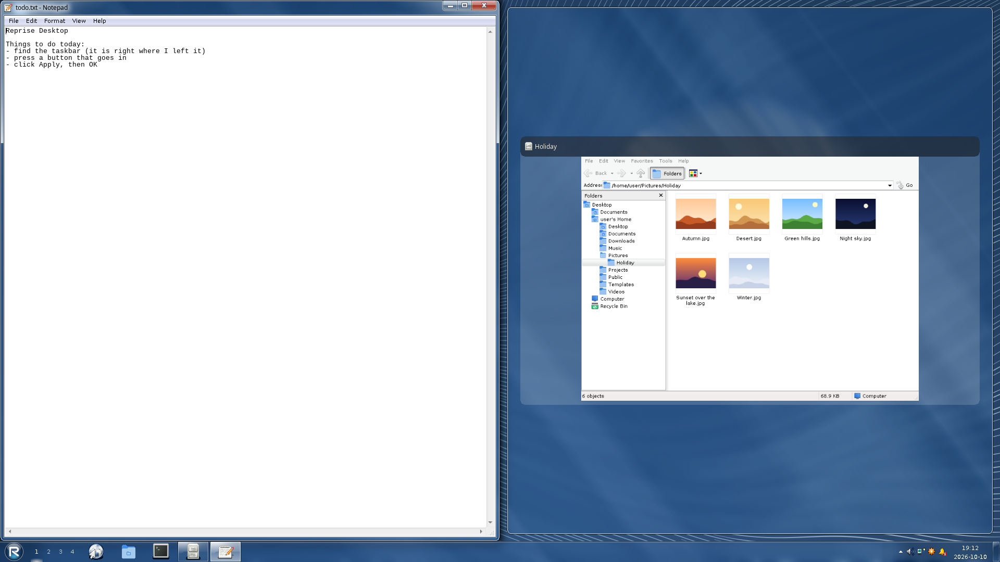

# Features

Everything Reprise does, grouped by where you'd go looking for it. The
programs that come with it have [their own page](programs.md), and the looks
have [theirs](interfaces.md). Shortcuts below are the defaults; every one but
the Super tap, Super+Shift+Esc and the VT switch keys can be rebound.

## Taskbar

- **Any edge.** `[taskbar] position` puts the bar along the bottom, top,
  left or right. Unlock the taskbar and drag empty bar space to another edge
  to move it, or drag a side bar's inner edge to make it wider. Popups open on
  the screen side of the bar, wherever that is.
- **Auto-hide.** The bar slides away to a 2 px line and comes back when the
  pointer rests on the line, on the Start key, Ctrl+Esc or Alt+Tab, or when
  something needs attention. Each trigger can be turned off. Over a fullscreen
  window only the Start key brings it back.
- **Four button modes.** One icon-only button per program, labelled buttons
  grouped only when the row is full, labelled buttons never grouped, or
  labelled buttons kept side by side per program. A grouped button lists its
  windows, with Minimize Group, Move to desktop and Close Group.
- **Pinned programs.** The Quick Launch programs can lead the task row
  instead of sitting in their own band. A pinned program with no windows is
  an icon that starts it, and its button takes that place once it runs.
- **Jump lists.** Right-click a task button for the files that program
  used recently, its windows, Pin or Unpin, Move to desktop and Close.
- **Drag to reorder.** Task buttons act when the mouse button comes up, so
  you can drag them along the row and the others slide aside. Middle-click
  starts another copy of the program.
- **Live previews.** Point at a task button for live pictures of its
  windows, each with its own close button. Minimized and covered windows
  keep updating, and an idle window costs nothing.
- **Peek.** Rest on a preview, or on the Show desktop strip, and every other
  window fades down to its frame.
- **Progress on the button.** A program that reports its progress (Explorer
  copying or deleting, any program using the LauncherEntry convention) fills
  its task button as it goes: a soft green fill in Glass, a thin bar along the
  bottom in Classic and Blue, amber or grey while paused.
- **Spring-loaded buttons.** Drag a file over a task button, wait half a
  second, and its window comes up so you can drop into it.
- **Cascade and tile.** The taskbar's menu cascades or tiles the windows,
  shows the desktop, starts the task manager or locks the bar.
- **Tray overflow.** Quiet tray icons wait behind an arrow (Classic and
  Blue) or a ^ flyout (Glass) and come back when they have something to say.
  Customize... sets each icon to always show, always hide, or follow its
  status.
- **Calendar.** Click the clock for the month, double-click it for Date and
  Time Properties. Under Glass an analog clock beside the month ticks each
  second while it's open, the time under it in hours and minutes.
- **From the keyboard.** Super+T lands on Start and Super+B on the
  notification area; your window greys while the bar has the keyboard. The
  arrows walk the buttons, Enter presses one, the Menu key opens its menu and
  Esc goes back to your window. A screen reader reads
  every button and can press it.

## Start menu and launcher

- **Start.** A tap on Super, Ctrl+Esc or the Start button. Classic and Blue
  have the cascading menu with Programs, Documents and Settings; Glass has
  the two-column menu with search and pinned programs
  (`startmenu_style` picks either under any look). Program rows drag out
  of the menu.
- **Your menu.** The Start Menu page of Reprise Settings edits the menu as a
  tree and Quick Launch as a list. Quick Launch is a folder of ordinary
  `.desktop` files in `~/.config/reprise/quicklaunch/`, and the taskbar
  follows it as it changes.
- **Live program list.** A program shows up in the Start menu and the
  launcher the moment it's installed. No refresh, no logging out.
- **Recent documents** from `recently-used.xbel`, shared with GTK and other
  programs. An open Documents menu, Recent Items or jump list takes a file
  opened meanwhile and drops one deleted. An open Start menu drops a
  document folder deleted meanwhile and shows one made.
  `[privacy] recent_files = false` hides them everywhere.
- **Launcher.** Super+Space, a few letters, Enter. It fuzzy-matches programs
  and settings pages ("wifi", "touchpad"), finds files in your home folder
  from two letters on, and does sums: `2+3*4`, Enter copies 14. File search
  uses plocate's database when it has one and `fd` when it doesn't, so
  nothing crawls your disk in the background. Right-click a row, or press
  the menu key, for the Start menu's program menu or a file's menu; Open
  file location (or Ctrl+Enter) shows the file selected in its folder.
- **Run...** for when you know exactly what you want. A folder's path (`~/Documents`) opens it in Explorer.

## Windows

- **Frames that work.** Minimize, maximize and close. Double-click the
  caption to maximize, the icon for the window menu, or double-click the icon
  to close. Super and a left drag moves a window by its body.
- **Window menu.** Alt+Space, or a right-click on the caption: Restore,
  Move, Size, Minimize, Maximize, Always on Top, Show on All Desktops, Move to
  Desktop, the tab commands and Close. Move and Size work from the keyboard.
- **Window tabs.** Drag a window by its caption onto another window's caption
  and hold it there: the two share one frame, their titles as tabs. A ghost
  tab shows where it lands, between two tabs or at either end. Click a
  tab to switch, drag it along to reorder or off to make it a window again.
  Super+\` and Super+Page Down show the next tab, Super+Page Up the one
  before. Each tab keeps its own taskbar button and Alt+Tab entry. Other
  taskbars and docks see a hidden tab as minimized; activating it there
  shows it in its group. A fullscreen group stays fullscreen as you switch
  tabs, and a hidden tab that asks for fullscreen gets it once you show it.
- **Shake.** Drag a window by its caption and shake it quickly from side to
  side, or up and down: every other window on that screen and desktop
  minimizes. Shake it again to bring back the ones it minimized. Windows
  kept on top and the shaken window's own dialogs stay. On by default under
  Glass (`[windows] shake`, or the Windows page of Reprise Settings).
- **Window memory.** A program opens where its last window closed: same
  screen, same size, maximized if it was.
- **Window rules** in the config match windows by app id and title, with
  globs, and pin their size, position, screen, desktop, state, always-on-top
  or sticky flag. `tab_group = "name"` puts every window its rules name the
  same into one tab group, each new one as the last tab. A window you pull
  out of that group stays out of it until you group it again.
- **Small conveniences.** Super+C centres a window on the screen under the
  pointer. Super+Shift+B hides its frame. Esc during a caption drag puts the
  window back where it was.
- **End Program.** Reprise pings windows, so one that stopped answering gets
  End Program as soon as you close it instead of after a wait.
- **Modal dialogs that stay modal.** Focus can't land behind a dialog a
  toolkit marked modal.
- **No focus stealing.** A window takes the keyboard only with a trusted
  activation token, after you clicked or launched something. Anything else
  opens behind the window you're typing in and flags its taskbar button.
  While the taskbar has the keyboard (Super+T), it opens on top with its
  button flagged and the keyboard stays on the taskbar.
- **Motion.** Windows fade and grow as they open and shrink as they close,
  caption buttons and Start fade their highlights, menus fade in. All
  optional (`[effects]`), on by default under Glass.

## Snapping

- **Edges and corners.** Drag a window to the left or right edge to fill
  that side, to the top to maximize it, into a corner for a quarter. Esc
  during the drag puts it back. With several screens only the outer edges
  of the whole arrangement snap: a window carried from one screen to the
  next lands where you let it go. `[window_snapping] distance`, or Snap
  distance from edges on the Windows page, sets how near an edge the drag
  has to come.
- **Snap layouts.** Rest on a maximize button, or press Super+Z, for six
  ways to split the screen: halves, two thirds and a third, thirds, a half
  and two quarters, quarters, and a wide middle column. A portrait screen
  gets rows. `[window_snapping] layouts`, or Custom layouts on the Windows
  page of Reprise Settings, replaces them with your own. The maximize
  button's tip names the keys, so a rebound Super+Z shows as bound.
- **The snap bar.** Drag a window toward the top of the screen and the
  layouts drop down. Hold the window over a zone and let go.
- **Suggestions.** The layouts start with your last few arrangements on
  that screen. Pick one and every window in it goes back to its zone.
- **Snap assist.** After a snap, the zones left over offer your other
  windows, live, one zone at a time, the zones still to fill outlined.
  Pick one, or press Esc and carry on.
- **Snap groups.** Drag the edge between two snapped windows and both
  resize. Each desktop keeps its own layout, and snapped windows keep their
  zones when the taskbar moves. A window moved to another desktop leaves its
  group.
- **From the keyboard.** Super and Left or Right step a window through the
  zones and on to the next screen. Super+Up steps up, then maximizes; Super+
  Down steps down, restores, then gives back the size from before the snap.
  Stepping into another window's zone swaps the two, and a step that leaves
  zones free offers snap assist for them. Hold Shift while dragging
  to drop into the zones of the layout you picked.

## Switching

- **Alt+Tab.** A grid of icons with a live picture of the selected window,
  or live pictures of every window. Minimized windows and dialogs are in the
  list, the desktop can be too, and resting on an entry peeks at it. Four
  picture sizes, for big screens and bad eyes. Pressed over an open Start
  menu, menu or popup, it closes that and switches.
- **3D switcher.** Glass only: Super+Tab tilts every window into a stack. See
  [interfaces](interfaces.md#glass-only).
- **Window overview.** Super+W, a hot corner (`[overview] hot_corner`) or
  three fingers up on a touchpad shows every window of the desktop side by
  side, live, each screen its own. Arrows pick, Enter shows, typing goes to
  the launcher.
- **Virtual desktops.** Four by default, up to sixteen, with a numbered pager
  on the taskbar that lights up when a window there wants you.
  Super+Ctrl+Left or Right switches; add Shift to take the window along. The
  switch can slide, fade, zoom or wipe, and three fingers sideways drag the
  slide along with them. A change to the number of desktops applies as soon
  as you save.

## Desktop

- **Icons** you can drag around, rename with F2, delete to the trash,
  refresh with F5 and right-click. Documents, Computer, Home and Recycle Bin are there if you
  want them, and the files in `~/Desktop` too. Labels hide file name extensions, only
  `.desktop`, or none (`desktop_extensions`); renaming a shown extension selects the name
  before it.
- **Trusted launchers.** A `.desktop` file on the desktop, or one the
  launcher finds, runs only once you've marked it trusted (Allow Launching),
  so a download can't pose as a program.
- **Program icons.** A file that runs when opened (below) wears the theme's
  program icon (`application-x-executable`) on the desktop, in Explorer and
  in file dialogs.
- **File dialogs remember their view.** Every Open and Save As dialog, in
  Reprise's programs, Run's Browse and the portal's, opens in the view and
  Details sort the last one was left in (`$XDG_STATE_HOME/reprise/filedialog.toml`).
- **Programs and scripts.** A file with its Executable box ticked
  (Properties) that holds a script (`#!`) or a binary runs when you open it,
  in its own folder, here and in Explorer. A script runs in your terminal,
  which waits for Enter after it ends unless `script_terminal = "close"`
  (Settings > Default Programs) and the script succeeded; a binary runs on
  its own. Edit and Open With still open it in an editor; any other
  executable file opens as usual. Its Properties sheet has no Opens with row
  and shows its name as the Description.
- **Wallpaper** centred, tiled or stretched, or a slideshow of a folder that
  crossfades every so often. The desktop menu skips to the next picture.
- **Desktop water.** The wallpaper ripples like a pond: the pointer leaves a
  wake, clicks and windows make waves, and `rain` drops one every second or
  so. Entirely unnecessary. Very relaxing. `ink`, `glow`, `sparks` and `neon`
  turn it into a fluid you stir by dragging on the desktop with the mouse or
  any number of fingers: taps burst, a held finger keeps pouring, a flick
  throws a jet, two twisting fingers make a whirlpool, and a double tap clears
  it. It drifts for about a minute after the last touch, then fades back to
  the wallpaper.
- **Screen savers.** Blank, a starfield, bouncing lines, a bouncing logo and
  your photos.

## Clipboard, emoji and screenshots

- **Clipboard history.** Super+V lists the last 25 things you copied, text
  and images. Type to filter, Del forgets one, Enter pastes it (with
  Ctrl+Shift+V in terminals). Password managers' copies are left out, and
  it lives in memory only.
- **Emoji picker.** Super+. opens a grid of emoji at the text caret. Search
  by name or shortcode, and Enter types it without touching the clipboard.
  It wants a colour emoji font.
- **Clipboard managers work,** and so does middle-click paste.
- **Screenshots.** PrtSc for the screen, Alt+PrtSc for the window,
  Ctrl+Alt+PrtSc for its content without the frame, Shift+PrtSc for a region
  or a clicked window. Every shot goes to the clipboard and, if you like, to
  Pictures/Screenshots.

## Notifications

- **Balloons** in the corner by the tray, with the buttons programs send. A
  chat app's Reply opens a text field right there. Left alone for two
  minutes, the field folds away (keeping what you typed for the next Reply)
  and the balloon makes room for the next.
- **History.** A bell in the tray keeps the session's notifications, grouped
  per program, each group with its own Clear. The arrows walk it, Enter runs
  a notification, Delete dismisses it and the Menu key lists its actions.
- **Bursts fold together.** A program that sends more than three balloons in
  ten seconds gets one "5 new from Mail" balloon instead.
- **Do Not Disturb** holds back all but the critical ones. They still go into
  the history.

We had notifications in 2001. They were allowed a small corner. They still
are.

## Lock, power and session

- **Lock screen** with a password or a fingerprint, whichever comes first.
  The password also unlocks your keyring if it was left locked. Prefer
  swaylock? `[power] locker` runs it, and if it crashes Reprise's own lock
  comes back.
- **Idle steps.** Screen saver, lock, screen off and suspend, each with its
  own timeout, and separate timeouts on battery.
- **Lock on sleep.** The screen locks before the machine suspends, whatever
  asked it to.
- **Laptop things.** Lid, power and sleep button actions, low and critical
  battery alarms, power profiles, and clamshell mode: close the lid with a
  monitor plugged in and the laptop screen steps aside.
- **A Turn Off dialog** that dims the desktop behind it. Shutting down used
  to have a little gravity.
- **Save prompts.** Log Off, Turn Off and Restart ask every window to close
  and wait, so programs can ask to save. After 5 seconds a list shows who's
  still holding things up, with End Now and Cancel. Turn Off and Restart ask
  logind first: when it says no, nothing closes. A refusal before or after
  the programs close (polkit, an inhibitor, a failing `[power]` command)
  shows a message saying why; a cancelled password prompt shows nothing.
  End Now overrides the inhibitors the list showed, which usually asks for
  a password; a critical battery overrides them too.
- **Session restore.** `[session] restore = true` starts the programs you
  left open again at the next login, on the desktops they were on. Tab
  groups come back in their tab order with the same tab shown, each where
  it was: same screen, size and maximized state, on the primary screen
  when its screen is gone. A window that opens with the title it had goes
  back to its own group and tab; others fill their program's tabs in order.
  A program
  starts once; if its other grouped windows aren't back 4 seconds after a
  window of it appears, it starts again for each one missing that no
  earlier start is still bringing, never more often than it had windows.
  Windows that don't come back within two minutes are left out.
- **XDG autostart,** with a Startup page in Reprise Settings to turn entries
  on and off.

## Displays

- **Multiple monitors,** each with its own mode, scale, rotation and
  adaptive sync. Reprise Settings arranges them by dragging numbered screens
  or moving the picked one with Ctrl+arrows, and a change you don't confirm reverts after 15 seconds.
  Windows move with the monitor they are on.
- **Fractional scaling** from 1 to 4 in quarter steps, per monitor. Programs
  that support it draw at the exact scale.
- **Night light** from sunset to sunrise, worked out from your time zone, or
  on a schedule. Each change fades over half an hour. A check box in the
  displays panel pauses it.
- A **displays icon** in the tray: scroll over it to dim or brighten every
  display at once; click it for a slider per display and the night light
  switch; right-click for night light's menu. The brightness keys change every
  display, and the on-screen display shows a line per display. The keyboard
  backlight has keys of its own.
- **Explicit sync** for the drivers that need it, NVIDIA's among them.

## Input

- **Keyboard layouts,** switched with Left Alt+Shift or from the layout
  square in the tray.
- **Input methods.** fcitx5 and ibus work in programs and in Reprise's own
  fields: Run, the launcher, the Start menu's search, a desktop rename and
  the dialogs.
- **Drop text into fields.** Text dragged from any program lands in a
  text field of Reprise's programs and dialogs, Run included, where the
  drop caret shows, and a drag held at the field's edge scrolls it.
  Dropped files give their paths, quoted when they hold a space. A file
  dropped on an Open or Save As dialog's File name gives its name, or its
  full path when it lies in another folder. The launcher's and the Start
  menu's search fields take a drop as the query, and a desktop icon's
  rename box takes it at the drop caret; files go into these by name.
- **Touchpad gestures.** Three fingers switch desktops and open the
  overview. Pinches and swipes with other finger counts go to the program,
  so a browser can pinch-zoom and swipe back. A lifted swipe runs on to
  where it was heading, and the overview's grids slide with the desktops.
  `[gestures]` sets the travel, the point past which a swipe goes through
  and the speed of a flick.
- **Touchscreens.** A program that takes touch gets touch; anywhere else a
  finger clicks and drags. Each touchscreen can be mapped to its screen.
- **Drawing tablets** with pressure, tilt and the pen's buttons. The pad's
  buttons, keys, rings, strips and dials run desktop actions or send key
  chords, set per pad in Reprise Settings.
- **Global shortcuts for programs.** A voice chat's push-to-talk works while
  another window has focus. The program asks once, and you can change its
  keys on the Keyboard page.
- **Media keys** for volume, mute, brightness, playback and Wi-Fi, with an
  on-screen panel. They work on the lock screen too.

## Accessibility

- **Screen readers.** Reprise's programs and its own Start menu, taskbar,
  switcher, launcher, dialogs, notification balloons and history speak
  AT-SPI. A balloon is announced when it appears. They're tested with Orca.
- **Magnifier** from 1x to 8x (Super+= and Super+-) that follows the pointer,
  the caret and the keyboard focus.
- **Colour filters:** grayscale, inverted, and corrections for three kinds of
  colour blindness. Super+Ctrl+C turns them off and on. Screenshots see the
  real colours.
- **Larger text** at 125% to 200% without changing the scale. The taskbar,
  menus, captions, Notepad and your GTK and Qt programs grow with it.
- **StickyKeys and SlowKeys,** offered when you press Shift five times or
  hold the right Shift for eight seconds.
- **MouseKeys:** the keypad moves the pointer, clicks and drags; hold Ctrl
  to go faster or Shift to creep a pixel at a time. Left Alt+Left Shift+Num
  Lock turns it on and off.
- **Access keys** underline once you press Alt, in the window you press it
  in, until that window loses the keyboard. A window opened from the keyboard
  underlines them from the start, as does a Reprise program started from the
  keyboard (a shortcut, the Run box, the Start menu's keys), and a menu bar opened with Alt or F10
  underlines its menus; one opened with the mouse underlines them only while
  its window does. A context menu
  opened with Shift+F10 or the Menu key underlines its own.
- When a shortcut turns StickyKeys, SlowKeys or MouseKeys on or off, a
  balloon says which; clicking it opens that aid's settings. So does
  clicking the StickyKeys or MouseKeys icon in the notification area.

## Hardware and network

- **Sound.** A speaker icon with a volume for each program playing sound,
  the default output and input, and the track that's playing with its
  buttons. Volume Control has balance, a Recording view and bass and treble
  where the card has them.
- **Network.** Wi-Fi, wired and VPN through NetworkManager. WireGuard and
  OpenVPN have their own editors (gateway, sign-in, certificates and keys,
  passwords), other VPNs import through NetworkManager's plugins, and Create
  Hotspot shares your connection. A captive portal gets a "Sign in to the
  network" balloon.
- **Bluetooth.** Pairing, connections and device batteries, from the tray.
- **Drives** mount when you plug them in, ask for a passphrase if they're
  encrypted, and eject from the tray or from Computer.
- **Printers.** Add, share, pause and manage printers and their queues, with
  a tray icon while something prints. Driverless printers just work.
- **Software Updates** checks system packages through PackageKit, Flatpaks
  and firmware, puts a balloon over the tray when it finds some, and installs
  only what you tick. It does not install anything on its own.
- **No driver discs.** Audio runs through PipeWire, networking through
  NetworkManager, Bluetooth through BlueZ and power through UPower and
  systemd-logind.

## Privacy and security

- **Indicators.** A red dot while the screen is shared, a microphone while a
  program records, a camera while one films and a pin while one reads your
  location. The tooltips name the program.
- **Capture border.** A red border on the screen around the screen, window
  or area being recorded or shared. Recordings never show it, and a single
  screenshot draws none. Settings > Advanced turns it off.
- **Prompts.** Screen sharing, remote control, input capture, location and
  camera access all ask first. Cancel or Deny is the default button, so a
  stray Enter never grants anything.
- **Sandboxed programs get less.** Flatpaks can't see the desktop's
  privileged protocols, such as input injection or screen capture.
- **Admin prompts.** A polkit agent asks for the password, or a finger, when
  a program needs root. The password goes to polkit, never to the program.
- **Location.** Reprise is the geoclue agent. It asks before a sandboxed
  program gets your location, remembers the answer if you like, and one
  switch turns location off for everyone. A prompt left unanswered for 24 s
  closes and the program is refused. Settings > Advanced lists the
  remembered answers, with the Flatpak programs' Location portal answers,
  and Forget drops one.

## Sharing and remote access

- **Screen sharing** in browsers, video calls and OBS, of a whole screen or
  one window.
- **Remote desktop.** Tools can drive the keyboard and mouse once you allow
  them.
- **One keyboard and mouse across computers** with Deskflow. Super+Shift+Esc
  always takes them back.
- **VM viewers and remote desktops get your shortcuts,** Super and Alt+Tab
  included, while they have focus. Super+Shift+Esc takes them back.
- **Pointer lock and raw motion** for games, 3D tools and VM viewers.

## Files

Explorer has thumbnails, five views, live folders, background copies, undo,
a shared freedesktop trash, Send To and drag and drop with every other
program. Sandboxed programs get Reprise's own Open, Save and Open With
dialogs. [More in programs.md](programs.md#explorer).

## Configuration

- **Live.** Edits to `config.toml` apply when you save, from Reprise Settings
  or a text editor.
- **Comments survive.** Reprise Settings writes back into `config.toml`
  without disturbing your comments, key order or the sections it doesn't
  touch.
- **Rebindable shortcuts,** modifier-only chords included.
- **Third-party tools work.** Panels, lockers, idle daemons, clipboard
  managers, pagers, gamma tools and display configurators work through the
  usual protocols. See [protocols.md](protocols.md).
- **A debug overlay** (`[debug] overlay`) shows frame times, commit times, damage, clients
  and memory in the corner of each screen. For when you want to know why.
- **A stuck display commit leaves Reprise running.** Each monitor's frames,
  power changes and gamma go to the kernel from that monitor's own thread,
  the reset that turns every display off on a return from another VT from
  one more thread, and exit waits at most half a second for them, so input, programs, the lock
  screen and VT switches carry on while a driver holds a commit. Other
  monitors wait for a mode change to finish, as the kernel holds their locks
  through it. Meanwhile hotplug scans and a reloaded config's output changes
  wait for it, and output-management tools are told the display is busy. A
  monitor stuck for over 2 s no longer holds up the lock screen or sleep,
  and a mode change that failed or took that long is tried again after 1, 2,
  4 ... up to 30 s. `REPRISE_COMMIT_DELAY=<connector>:<ms>` in Reprise's
  environment makes every commit on that connector wait `ms` first
  (`HDMI-A-1:5000:modeset` only its modesets), to try it.

## Not yet

- One GPU at a time. No multi-GPU setups and no DRM leases for VR headsets.
- No HDR or colour management.
- X11 programs draw at scale 1 and are scaled up on HiDPI screens.
- No help viewer. The ? buttons are there for decoration.
