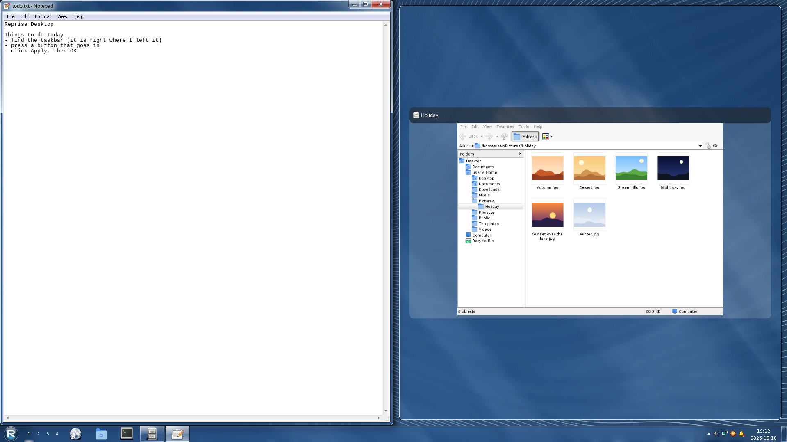

# Features

Everything Reprise does, grouped by where you'd go looking for it. The
programs that come with it have [their own page](programs.md), and the looks
have [theirs](interfaces.md). Shortcuts below are the defaults; every one but
the Super tap, Super+Shift+Esc and the VT switch keys can be rebound.

## Taskbar

- **Any edge.** `[taskbar] position` puts the bar along the bottom, top,
  left or right. Unlock the taskbar and drag empty bar space to another edge
  to move it, or drag a side bar's inner edge to make it wider. Popups open on
  the screen side of the bar, wherever that is.
- **Auto-hide.** The bar slides away to a 2 px line and comes back when the
  pointer rests on the line, on the Start key, Ctrl+Esc or Alt+Tab, or when
  something needs attention. Each trigger can be turned off. Over a fullscreen
  window only the Start key brings it back.
- **Four button modes.** One icon-only button per program, labelled buttons
  grouped only when the row is full, labelled buttons never grouped, or
  labelled buttons kept side by side per program. A grouped button lists its
  windows, with Minimize Group, Move to desktop and Close Group.
- **Pinned programs.** The Quick Launch programs can lead the task row
  instead of sitting in their own band. A pinned program with no windows is
  an icon that starts it, and its button takes that place once it runs.
- **Quick Launch overflow.** Unlocked, a band's grip drags the Quick Launch
  band shorter than its buttons. The ones that no longer fit move behind a »
  at its end, which lists them with their icons; right-click one for its
  Open and Delete menu.
- **Jump lists.** Right-click a task button for the files that program
  used recently, its windows, Pin or Unpin, Move to desktop and Close.
- **Drag to reorder.** Task buttons act when the mouse button comes up, so
  you can drag them along the row and the others slide aside. Middle-click
  starts another copy of the program.
- **Live previews.** Point at a task button for live pictures of its
  windows, each with its own close button. Minimized and covered windows
  keep updating, and an idle window costs nothing.
- **Peek.** Rest on a preview, or on the Show desktop strip, and every other
  window fades down to its frame.
- **Attention.** A window that asks for attention (an activation it may not
  take focus for, X11 urgency, or a window opening behind the one you use)
  flashes its task button for 30 s (`[taskbar] attention_flash`), then keeps
  it lit until you focus the window.
- **Progress on the button.** A program that reports its progress (Explorer
  copying or deleting, any program using the LauncherEntry convention) fills
  its task button as it goes: a soft green fill in Glass, a thin bar along the
  bottom in Classic and Blue, amber or grey while paused.
- **Unread badges.** A program that reports an unread count through the
  LauncherEntry convention shows it in a small badge in its task buttons'
  corner, pinned and grouped buttons included (`99+` above 99; `[taskbar]
  badges`). One that marks itself urgent flashes its windows' buttons.
- **Spring-loaded buttons.** Drag a file over a task button, wait half a
  second, and its window comes up so you can drop into it.
- **Cascade and tile.** The taskbar's menu cascades or tiles the windows,
  shows the desktop, starts the task manager (also Ctrl+Shift+Escape) or locks the bar.
- **Tray overflow.** Quiet tray icons wait behind an arrow (Classic and
  Blue) or a ^ flyout (Glass) and come back when they have something to say.
  Customize... sets each icon to always show, always hide, or follow its
  status.
- **Calendar.** Click the clock for the month, double-click it for Date and
  Time Properties. Under Glass an analog clock beside the month ticks each
  second while it's open, the time under it in hours and minutes.
- **From the keyboard.** Super+T lands on Start and Super+B on the
  notification area; your window greys while the bar has the keyboard. The
  arrows walk the buttons, Enter presses one, the Menu key opens its menu and
  Esc goes back to your window. A screen reader reads
  every button and can press it.

## Start menu and launcher

- **Start.** A tap on Super, Ctrl+Esc or the Start button. Classic has the
  cascading menu with Programs, Documents and Settings; Blue has two
  columns of pinned programs and places with All Programs as cascading
  menus; Glass has two columns with search and pinned programs
  (`startmenu_style` picks any of them under any look). Program rows drag
  out of the menu.
- **Your menu.** The Start Menu page of Reprise Settings edits the menu as a
  tree and Quick Launch as a list. Quick Launch is a folder of ordinary
  `.desktop` files in `~/.config/reprise/quicklaunch/`, and the taskbar
  follows it as it changes.
- **Live program list.** A program shows up in the Start menu and the
  launcher the moment it's installed. No refresh, no logging out.
- **Recent documents** from `recently-used.xbel`, shared with GTK and other
  programs. A file opened from the desktop, Explorer, Open With or Run goes
  in too. An open Documents menu, Recent Items or jump list takes a file
  opened meanwhile and drops one deleted. An open Start menu drops a
  document folder deleted meanwhile and shows one made.
  `[privacy] recent_files = false` hides them everywhere and records none.
- **Launcher.** Super+Space, a few letters, Enter. It fuzzy-matches programs,
  finds settings pages, settings programs and the settings on them ("wifi",
  "touchpad", "repeat delay"; a setting opens its page with that control focused), finds files in
  your home folder from two letters on, and does sums: `2+3*4`, Enter copies 14. It converts
  units too: `5 km in mi`, `30 c to f`, `2 gib in mb`, `3 ft 4 in = cm`
  show `5 km = 3.10686 mi` and Enter copies the number. Length, mass, volume,
  temperature, area, speed, time, data (`mb` is a megabyte, `mib` a mebibyte,
  `mbit` or `mbps` a megabit), pressure, energy and power; the amount can be
  a sum (`2*3 km in m`). File search
  uses plocate's database when it has one and `fd` when it doesn't, so
  nothing crawls your disk in the background. Right-click a row, or press
  the menu key, for the Start menu's program menu or a file's menu; Open
  file location (or Ctrl+Enter) shows the file selected in its folder.
  Open windows show up too, by title or program name, on any desktop:
  Enter brings one back, restoring it if minimized. When a window matches
  as well as a program, it comes first, so "fire" Enter goes back to the
  browser you have open. `[launcher] windows = false` turns that off.
- **Run...** for when you know exactly what you want. A folder's path (`~/Documents`) opens it in Explorer.

## Windows

- **Frames that work.** Minimize, maximize and close. Double-click the
  caption to maximize (or roll up, minimize or nothing: `[windows]
  title_double_click`, or the Window Behavior page of Reprise Settings), the icon for
  the window menu, or double-click the icon to close. Super and a left drag
  moves a window by its body.
- **Window menu.** Alt+Space, or a right-click on the caption: Restore,
  Move, Size, Minimize, Maximize, Roll Up, Always on Top, Always Open Here,
  Mini View, Show on All Desktops, Move to Desktop, the tab commands and
  Close. Move and Size work from the keyboard.
- **Always Open Here.** Ticked in the window menu, it writes a window rule
  for the program's app id: its windows open on this screen, at this place
  and size (the restored one when maximized), maximized if it is, and on top
  or on every desktop when it is. Unlike window memory, moving a window
  later does not change it. Ticking it on another window of the program
  replaces the rule; unticking removes it. Greyed for a window without an
  app id, and dialogs don't have it.
- **Roll up.** Roll Up in the window menu (or a caption double-click set to
  it) leaves only the window's title bar, at its width; the program keeps
  running at its size and gets no input. It moves like any window. Roll Down,
  its task button, maximizing, snapping or going fullscreen brings it back.
- **Mini view.** Mini View in the window menu (or a `mini-view` bind, unbound
  by default) opens a small live picture of the window, 320 pixels wide in
  the lower-right corner of its screen, above every window and on every
  desktop. Drag it to move it, drag its lower-right corner to size it (it
  keeps the window's shape); a click brings the window up, and a
  double-click or its close box closes it. It keeps following a minimized
  window. Several windows can each have one; Mini View again, or closing the
  window, closes it. Screenshots and screen sharing show it like anything
  else on screen.
- **Window tabs.** Drag a window by its caption onto another window's caption
  and hold it there: the two share one frame, their titles as tabs. A ghost
  tab shows where it lands, between two tabs or at either end. Click a
  tab to switch, drag it along to reorder or off to make it a window again.
  Super+\` and Super+Page Down show the next tab, Super+Page Up the one
  before. Each tab keeps its own taskbar button and Alt+Tab entry. Other
  taskbars and docks see a hidden tab as minimized; activating it there
  shows it in its group. A fullscreen group stays fullscreen as you switch
  tabs, and a hidden tab that asks for fullscreen gets it once you show it.
- **Shake.** Drag a window by its caption and shake it quickly from side to
  side, or up and down: every other window on that screen and desktop
  minimizes. Shake it again to bring back the ones it minimized. Windows
  kept on top and the shaken window's own dialogs stay. On by default under
  Glass (`[windows] shake`, or the Window Behavior page of Reprise Settings).
- **Dim inactive windows.** Every window but the focused one draws darker by
  `[windows] dim_inactive` percent (0 to 40, off by default; the Window Behavior page
  of Reprise Settings). A focused dialog keeps its parent bright and a focused
  window its dialogs. Only the client area darkens, not the frame. Full-screen
  windows, Alt+Tab and taskbar previews, the 3D switcher and window screenshots
  stay bright; a screenshot or screencast of the whole screen shows it as seen.
  The shade fades in 150 ms when `[effects] window_animation` is on.
- **Window memory.** A program opens where its last window closed: same
  screen, same size, maximized if it was. A second window of it cascades
  from the first. A window that names itself with an xdg-toplevel-tag no
  dialog uses (each sticky note does) keeps a place of its own under that
  name. Docked and undocked layouts each keep their own places
  (per set of connected screens, by make, model and serial), in
  `$XDG_STATE_HOME/reprise/windows.toml`. A place left off every screen opens
  at the default place instead. Window rules that set a size or position
  win. Forget Positions on the Window Behavior page of Reprise Settings drops them
  all (`[windows] remember`).
- **Window rules** in the config match windows by app id and title, with
  globs, and pin their size, position, screen, desktop, state, always-on-top
  or sticky flag. `tab_group = "name"` puts every window its rules name the
  same into one tab group, each new one as the last tab. A window you pull
  out of that group stays out of it until you group it again. Every rule
  that matches applies in file order, so a later one wins key by key. The
  window menu's Always Open Here writes its rule last, marked
  `from_menu = true`, and leaves your own rules as they are.
- **Small conveniences.** Super+C centres a window on the screen under the
  pointer. Super+Shift+B hides its frame. Esc during a caption drag puts the
  window back where it was.
- **End Program.** Reprise pings windows, so one that stopped answering gets
  End Program as soon as you close it instead of after a wait. While Task
  Manager is open, every window is pinged every 5 s and one that stopped
  answering shows as Not Responding there. A program
  that has exited or been killed while one of its threads hangs on a dead
  mount stops answering too; its windows go without End Program, within a
  quarter second when another of its threads exits (Linux 6.9+), else within
  2 s.
- **Modal dialogs that stay modal.** Focus can't land behind a dialog a
  toolkit marked modal.
- **No focus stealing.** A new window takes the keyboard with a trusted
  activation token, when Reprise started its program in the last 30 s, when
  it belongs to the focused window's program (same connection, a child
  process, a process in its session, a pane of the terminal multiplexer the
  focused terminal runs), when the focused window owns it, when it is a
  Reprise prompt, or when nothing has focus; [security.md](security.md#focus)
  has the details. Anything else
  opens behind the window you're typing in and flags its taskbar button.
  While the taskbar has the keyboard (Super+T), it opens on top with its
  button flagged and the keyboard stays on the taskbar.
- **Motion.** Windows fade and grow as they open and shrink as they close,
  caption buttons and Start fade their highlights, menus fade in (or
  unroll from the side they open from, `menu_animation = "slide"`). All
  optional (`[effects]`), on by default under Glass; menus fade under every
  interface.
- **Menus past the window's edge.** The menu bars, context menus, drop-down
  lists and colour palettes in Reprise's own programs, the file dialog's
  included, open on popups of their own, so a menu shows whole below a short
  window, keeps its full width beside a narrow one and turns up or left at the
  screen's edge.

## Snapping

- **Edges and corners.** Drag a window to the left or right edge to fill
  that side, to the top to maximize it, into a corner for a quarter. Esc
  during the drag puts it back. With several screens only the outer edges
  of the whole arrangement snap: a window carried from one screen to the
  next lands where you let it go. `[window_snapping] distance`, or Snap
  distance from edges on the Window Behavior page, sets how near an edge the drag
  has to come.
- **Snap layouts.** Rest on a maximize button, or press Super+Z, for six
  ways to split the screen: halves, two thirds and a third, thirds, a half
  and two quarters, quarters, and a wide middle column. A portrait screen
  gets rows. `[window_snapping] layouts`, or Custom layouts on the Window
  Behavior page of Reprise Settings, replaces them with your own. The maximize
  button's tip names the keys, so a rebound Super+Z shows as bound.
- **The snap bar.** Drag a window toward the top of the screen and the
  layouts drop down. Hold the window over a zone and let go.
- **Suggestions.** The layouts start with your last few arrangements on
  that screen. Pick one and every window in it goes back to its zone.
- **Snap assist.** After a snap, the zones left over offer your other
  windows, live, one zone at a time, the zones still to fill outlined.
  Pick one, or press Esc and carry on.
- **Snap groups.** Drag the edge between two snapped windows and both
  resize, keeping their size from before the snap for when they are dragged
  out. Dragging an edge no other window shares unsnaps the window. Each
  desktop keeps its own layout, and snapped windows keep their zones when
  the taskbar moves. A window moved to another desktop leaves its
  group. A group whose windows are all on every desktop holds on whichever
  desktop is shown; one with a window on a single desktop holds only there.
- **From the keyboard.** Super and Left or Right step a window through the
  zones and on to the next screen. Super+Up steps up, then maximizes; Super+
  Down steps down, restores, then gives back the size from before the snap.
  Stepping into another window's zone swaps the two, and a step that leaves
  zones free offers snap assist for them. Hold Shift while dragging
  to drop into the zones of the layout you picked.

## Switching

- **Alt+Tab.** A grid of icons with a live picture of the selected window,
  or live pictures of every window. Minimized windows and dialogs are in the
  list, the desktop can be too, and resting on an entry peeks at it. Four
  picture sizes, for big screens and bad eyes. Pressed over an open Start
  menu, menu or popup, it closes that and switches.
- **Alt+` (the key above Tab on any layout)** switches between the windows
  of the focused app alone, most recent first, in the same panel. Shift goes
  the other way.
- **3D switcher.** Glass only: Super+Tab tilts every window into a stack. See
  [interfaces](interfaces.md#glass-only).
- **Window overview.** Super+W, a hot corner (`[overview] hot_corner`) or
  three fingers up on a touchpad shows every window of the desktop side by
  side, live, each screen its own. Arrows pick, Enter shows, typing goes to
  the launcher.
- **Virtual desktops.** Four by default, up to sixteen, with a numbered pager
  on the taskbar that lights up when a window there wants you.
  Super+Ctrl+Left or Right switches; add Shift to take the window along. The
  wheel over the pager steps to the previous or next desktop, and over the
  desktop too with `[workspaces] wheel_on_desktop = true`. The
  switch can slide, fade, zoom or wipe, and three fingers sideways drag the
  slide along with them. A change to the number of desktops applies as soon
  as you save. Each desktop can have a name (`[workspaces] names`): the
  pager's tip and the Move to desktop menus show it, and right-clicking a
  pager button offers Rename Desktop.

## Desktop

- **Icons** you can drag around, rename with F2, delete to the trash,
  refresh with F5 and right-click. Documents, Computer, Home and Recycle Bin are there if you
  want them, and the files in `~/Desktop` too. Labels hide file name extensions, only
  `.desktop`, or none (`desktop_extensions`); a name whose rest ends in a known extension
  too (`report.pdf.sh`) shows in full. Renaming a shown extension selects the name
  before it.
- **Open in Terminal** on the desktop's right-click menu, a folder's and
  Documents' or Home's starts your `terminal` there.
- **Widgets.** A clock, a month calendar and a system meter can stand on
  the desktop: tick them under the desktop menu's Widgets or in Settings >
  Background (`desktop_widgets`). Each is glass under Glass and a raised
  panel otherwise. Drag one to move it: it snaps to the icon grid, on any
  screen, and the icons make way. Right-click it for its options (the
  clock's analog or digital face and its seconds, the meter's bars or
  graph) and Remove. Each screen keeps its own place for each widget, in
  `$XDG_STATE_HOME/reprise/widgets.toml`. A widget redraws only when what
  it shows changes; the meter reads CPU and memory use once a second and
  stops while the desktop is hidden (locked, the screen saver, a full-screen
  window).
- **Trusted launchers.** A `.desktop` file on the desktop, or one the
  launcher finds, runs only once you've marked it trusted (Allow Launching),
  so a download can't pose as a program.
- **Program icons.** A file that runs when opened (below) wears the theme's
  program icon (`application-x-executable`) on the desktop, in Explorer and
  in file dialogs.
- **File dialogs remember their folder, view and place, per app.** Every
  Open and Save As dialog, in Reprise's programs, Run's Browse and the
  portal's, opens in the folder that app's last dialog was confirmed in, in
  its view and Details sort, and at the size and place it was left at
  (`$XDG_STATE_HOME/reprise/filedialog.toml`, a table per app id; a portal
  dialog counts as the app that asked for it and takes its app id, grouping
  with it on the taskbar under its icon, Run's Browse as `reprise`, and
  dialogs whose app is unknown share `""`; the 32 apps written last are
  kept). A folder the program or the portal's caller names wins over the
  last one. The size grows with the text size and stays inside the screen.
  With no place kept, or one whose title bar is off every screen, a program's
  dialog opens centred on the screen its window is on. A maximized dialog
  leaves its restored size.
- **File dialogs follow their folder.** A file or folder made, deleted or
  renamed in the folder an Open or Save As dialog shows lists at once, the
  selection and scroll staying where their entries still are. The folder
  shown, renamed or moved, is followed; deleted, the dialog moves to the
  nearest folder above it.
- **File dialog keys and menu.** In an Open or Save As dialog F5 and Ctrl+R
  list the folder again, Alt+Left and Alt+Right go back and forward, Alt+Up
  goes up a folder and Ctrl+Shift+N makes a new folder, named in place. In
  the list F2 renames the selected entry in place, Delete deletes the
  selection as Explorer's Delete does (asking first as the Recycle Bin's
  settings say, and asking before deleting for good what the Recycle Bin
  cannot take), Shift+Delete, or the menu's Delete clicked with Shift held,
  deletes it for good once asked, Ctrl+A selects every file where several
  can be picked, and a right click, Shift+F10 or the Menu key opens the
  entry's menu (Select, Pin to Places for a folder, Delete, Rename) or the
  background's (View, Refresh, New > Folder). A refused rename or a failed
  delete says why in a box.
  File name keeps its editing keys.
- **Pinned folders.** Pin to Places on a folder's right-click menu (in
  Explorer's view and Folders tree, on the desktop and in a file dialog's
  list) pins it; Unpin from Places takes it off. The Documents and Home
  places count as folders, Computer and the Recycle Bin do not. Pinned folders sit after the built-in tiles in every
  file dialog's places bar (Reprise's programs, the portal's dialog, Run's
  Browse), where a pinned tile's own menu opens, unpins or moves it up and
  down, and the bar scrolls once they overflow it. Explorer's task pane lists
  them in a Pinned group at the top. They are the `file://` lines of GTK's
  bookmarks file (`$XDG_CONFIG_HOME/gtk-3.0/bookmarks`), so GTK programs'
  sidebars and GTK's file chooser share them, and a change shows in every
  window at once. Up to 20 are shown; a folder that is not there (an unplugged
  drive's) shows greyed, and one on a network mount is never looked for.
- **File dialog band select.** In an Open dialog that picks several files, a
  drag from the list's background draws a band that selects every entry it
  touches; with Ctrl it adds them to the selection (or takes off those
  already in it), Escape puts the selection back, and past the list's edge
  the list scrolls toward the pointer. Ctrl+click and Shift+click pick
  several as in Explorer.
- **Programs and scripts.** A file with its Executable box ticked
  (Properties) that holds a script (`#!`) or a binary runs when you open it,
  in its own folder, here and in Explorer. The first time you open a
  script, a box asks whether to run it or open it in Notepad; a binary, or
  a file whose program runs it (a `.exe` under Wine, a Java
  archive, an AppImage), asks Run or Cancel, with Cancel on Enter. Run is
  remembered for that file until it changes (`confirm_scripts = false`
  never asks). The Start menu's Documents, jump lists and search ask the
  same way. A program started from an
  installed application entry never asks. A
  script runs on its own, or in
  your terminal with `script_open = "terminal"` (Settings > Default
  Programs); its menu has Run and Run in terminal in place of Open, the
  default in bold. The terminal waits for Enter after the script ends unless
  `script_terminal = "close"` and the script succeeded; a closing terminal
  first gives the children the script started with `setsid` up to 2 s to
  leave it. A binary runs on its own. Edit and Open With still open it in an editor; any other
  executable file opens as usual. Its Properties sheet has no Opens with row
  and shows its name as the Description.
- **Wallpaper** centred, tiled or stretched, or a slideshow of a folder that
  crossfades every so often. The desktop menu skips to the next picture. Each
  virtual desktop can have a picture of its own, faded in as you switch.
- **Desktop water.** The wallpaper ripples like a pond: the pointer leaves a
  wake, clicks and windows make waves, and `rain` drops one every second or
  so. Entirely unnecessary. Very relaxing. `ink`, `glow`, `sparks` and `neon`
  turn it into a fluid you stir by dragging on the desktop with the mouse or
  any number of fingers: taps burst, a held finger keeps pouring, a flick
  throws a jet, two twisting fingers make a whirlpool, and a double tap clears
  it. It drifts for about a minute after the last touch, then fades back to
  the wallpaper.
- **Screen savers.** Blank, a starfield, bouncing lines, a bouncing logo and
  your photos.

## Clipboard, emoji and screenshots

- **Clipboard history.** Super+V lists the last 25 things you copied, text
  and images. Type to filter, Del forgets one, Enter pastes it (with
  Ctrl+Shift+V in terminals). Password managers' copies are left out, and
  it lives in memory only. The last copy stays on the clipboard after the
  program that made it quits.
- **Emoji picker.** Super+. opens a grid of emoji at the text caret. Search
  by name or shortcode, and Enter types it without touching the clipboard.
  It wants a colour emoji font.
- **Path completion.** Typing a path (`~/Doc`, `/usr/sh`) in Run, Explorer's
  address bar or a file dialog's File name completes the name inline, the
  completed part selected so typing goes on over it, and lists the matches
  under the box: folders first, ending in `/`. Up and Down pick one, Enter or
  Tab take it, Escape closes the list. Hidden names show once the typed name
  starts with a dot; matching is case-sensitive. File name completes from the
  dialog's folder, Run from a word starting with `/` or `~`.
- **Clipboard managers work,** and so does middle-click paste.
- **Edit menu.** A right-click in a text field, Shift+F10 or the Menu key
  opens Undo, Redo, Cut, Copy, Paste, Delete and Select All: in Run and the other
  dialogs, the Start menu's search, the launcher, the clipboard history, the
  emoji picker, a notification's reply field, the desktop's rename box, the
  file dialogs' File name, Settings and its dialogs, Explorer's address bar
  and rename box, and every spin box.
  In the launcher and the Start menu's search those keys open a lit row's
  menu first. Paste greys while the clipboard holds no text, and a password
  field keeps Cut and Copy greyed. In a program's window the menu opens on a
  popup of its own, like the program's other menus.
- **Screenshots.** PrtSc for the screen, Alt+PrtSc for the window,
  Ctrl+Alt+PrtSc for its content without the frame, Shift+PrtSc for a region
  or a clicked window. Every shot goes to the clipboard and, if you like, to
  Pictures/Screenshots.
- **Colour picker.** Super+Shift+C turns the pointer into a crosshair with a
  loupe beside it: the 9 x 9 pixels round the point, the centre one ringed,
  and its `#RRGGBB` under them. It follows the pointer across screens; the
  arrow keys nudge it a pixel. A click or Enter copies the colour as
  `#rrggbb` and shows it in a notice; Esc or a right-click cancels. Programs
  asking through the Screenshot portal's PickColor get the same picker.

## Notifications

- **Balloons** in the corner by the tray, with the buttons programs send:
  up to three, then a "..." button with the rest. Buttons that do not fit on
  one row wrap onto a second, so every label shows whole. A chat app's Reply opens a text field right there. Left alone for two
  minutes, the field folds away (keeping what you typed for the next Reply)
  and the balloon makes room for the next. A program that sets the
  `action-icons` hint gets each button's icon in place of its label, with
  the label as the icon's tooltip.
- **History.** A bell in the tray keeps the session's notifications, grouped
  per program, each group with its own Clear. The arrows walk it, Enter runs
  a notification, Delete dismisses it and the Menu key lists its actions.
- **Bursts fold together.** A program that sends more than three balloons in
  ten seconds gets one "5 new from Mail" balloon instead.
- **Per program.** Right-click a program's group in the history, or press the
  Menu key on it, for Don't Show Balloons and No Sounds. Its notifications
  still go into the history, and critical ones still show. Settings >
  Notifications lists the programs that sent notifications this session with
  the same two switches (`[notifications] no_balloons` and `no_sounds`).
- **Do Not Disturb** holds back all but the critical ones. They still go into
  the history. It also turns itself on during `[notifications] quiet_hours`,
  and while a full-screen window has focus or the screen is shared unless
  `auto_dnd = false`; the balloons it held then show once that ends.
  Right-click the bell, or the history's check box, to turn it on for an
  hour or until tomorrow: 08:00, or the end of quiet hours that run past
  midnight. The menu, the check box and the bell's tooltip then say until
  when, and Turn off ends it early. It lasts through a config reload, not
  past the session.

We had notifications in 2001. They were allowed a small corner. They still
are.

## Lock, power and session

- **Lock screen** with a password or a fingerprint, whichever comes first.
  The password also unlocks your keyring if it was left locked. An expired
  password still unlocks; the next login that starts a new session asks for
  a new one. Prefer
  swaylock? `[power] locker` runs it, and if it crashes Reprise's own lock
  comes back. With more than one keyboard layout, the Unlock dialog shows
  the active one in its corner, as the taskbar does.
- **Idle steps.** Screen saver, lock, screen off and suspend, each with its
  own timeout, and separate timeouts on battery.
- **Lock on sleep.** The screen locks before the machine suspends, whatever
  asked it to.
- **Lock when away.** Pick your phone on the Screen Saver & Lock page and the
  session locks once it has been disconnected for `[lock] away_after_s`
  (30 s). The phone has to keep a Bluetooth connection while you're near,
  as it does for calls or KDE Connect ([configuration.md](configuration.md#lock-when-away)).
  It never unlocks.
- **Laptop things.** Lid, power and sleep button actions, low and critical
  battery alarms, power profiles, and clamshell mode: close the lid with a
  monitor plugged in and the laptop screen steps aside.
- **Battery charge limit.** On a laptop whose battery driver supports one,
  Power Options' Power Meter tab has "Limit charging to protect the battery",
  which turns UPower's charge limit on or off at once. The thresholds are
  UPower's and the kernel's; the row shows where charging stops.
- **A Turn Off dialog** that dims the desktop behind it. Shutting down used
  to have a little gravity. Hold Shift and Stand By turns into Hibernate;
  an empty `[power] standby` greys Stand By.
- **Save prompts.** Log Off, Turn Off and Restart ask every window to close
  and wait, so programs can ask to save. After 5 seconds a list shows who's
  still holding things up, with End Now and Cancel. Turn Off and Restart ask
  logind first: when it says no, nothing closes. A refusal before or after
  the programs close (polkit, an inhibitor, a failing `[power]` command)
  shows a message saying why; a cancelled password prompt shows nothing.
  Stand By and Hibernate close nothing, and say why the same way when the
  computer stays up.
  End Now overrides the inhibitors the list showed, which usually asks for
  a password; a critical battery overrides them too.
- **Session restore.** The programs you left open start again at the next
  login, on the desktops they were on; `[session] restore = false` turns it
  off. The list is taken at Log Off, Turn Off and Restart, and every 5
  seconds while the session runs, so a crash leaves a fresh one. Tab
  groups come back in their tab order with the same tab shown, each where
  it was: same screen, size and maximized state, on the primary screen
  when its screen is gone. A window that opens with the title it had goes
  back to its own group and tab; others fill their program's tabs in order,
  and move to their own tab when they take its title within 10 seconds. A
  window with the title of one the program had outside any group stays out
  of the groups. Snapped windows go back into their zones of the same
  layout, together in one snap group, on the monitor and desktop they were
  on; a window takes the zone saved with the title it opens with, else its
  program's first free zone, unless the title is one of the program's other
  windows'. When that monitor is gone they open unsnapped. A program
  starts once; if its other grouped windows or its windows outside the
  groups aren't back 4 seconds after a window of it appears, it starts
  again for each one missing that no
  earlier start is still bringing, never more often than it had windows.
  Windows that don't come back within two minutes are left out. When
  Reprise stops before the restored programs' first windows are back, the
  next start restores nothing, so a program that brings Reprise down is
  not started into it again.
- **XDG autostart,** with a Startup page in Reprise Settings to turn entries
  on and off.
- **Crash recovery.** When Reprise panics it starts again in place: the
  same binary, with the same arguments and environment, runs a new session
  on the same seat and opens a new display socket. Programs with windows
  don't survive it, as their connection to the display goes with the crash;
  session restore starts them again from a list at most 5 seconds old, and
  autostart runs again. Programs without a window keep running, in their
  app scopes, so autostart skips an entry whose scope still runs and the
  `--startup` command is not run again. A session that was locked comes back locked, before its
  first frame, and a notice says it restarted. A second crash within a
  minute of a restart ends the session and the login manager shows its
  greeter; the log counts the crashes and keeps each backtrace. A crash by
  a signal, such as a segfault, ends the session without a restart.

## Login screen

Reprise brings its own login manager, `reprise-login`. It's installed
switched off; [install.md](install.md#login-manager) says how to switch to
it and back. `[login] interface` in `/etc/reprise/login.toml` picks the
design ([configuration.md](configuration.md#login-manager)), and without it
the screen takes the interface of the last session used at this computer.

- **Classic** is a Log On to Reprise dialog on the desktop colour: a band
  with the Reprise mark, User name and Password rows, and OK, Cancel and
  Shut Down... buttons.
- **Blue** is a welcome screen between two dark bands: the mark on the
  left, a column of user tiles on the right ("To begin, click your user
  name") and Turn off computer in the bottom band.
- **Glass** shows the last user's picture over the wallpaper with a
  password field and a round arrow, the other users' tiles one click away,
  and a power button in the corner.
- **Switching users.** Each user's session runs on a VT of its own. Switch
  User in the Log Off dialog, or on the lock screen, brings the login
  screen back while your session keeps running, locked; its tile says
  Logged on. Logging in again goes straight back to it, unlocked. One
  session per user: a second login resumes the first. After a restart of
  the login manager, a session it can't read yet keeps a login of that user
  waiting.
- **Shut Down and Restart** from the login screen. While anyone is still
  logged on, the screen first asks for an administrator's name and
  password: a member of `wheel`, never root. Shutting down then ends every
  session, unsaved work included. A wrong password and a name that isn't an
  administrator's are both refused 3 s after the last answer. An
  administrator whose password must be changed is refused until they log
  in and change it.
- **PAM's messages.** A wrong name or password gets one fixed message.
  What PAM says during the login (an account locked after failed logins,
  `/run/nologin`'s text, an expired account) stays on screen in its words.
- **Caps Lock and layouts.** "Caps Lock is on." shows under the password
  while it is. With more than one keyboard layout set for the system, a
  badge shows the active one, and clicking it moves to the next.
- **Autologin.** `[login] autologin_user` logs one user in when the
  computer starts. Logging off brings the login screen.
- **Remote logins.** A user connected from another computer has a tile
  that says Connected remotely. Logging in here as that user brings the
  session to this screen. For a background session, or one in lock mode,
  that ends the remote connection, and the client is told another
  connection took over; a session showing its screen keeps its client
  ([Remote logins](#remote-logins)). Switch User sends the session back to
  the background, locked, and the next remote login of its user lands in it
  again.
- **A safety net.** A session that ends as soon as it starts brings the
  login screen back with a note pointing at its log. A login screen that
  fails three times in a row gives way to a text login on tty2.

## Displays

- **Multiple monitors,** each with its own mode, scale, rotation and
  adaptive sync. Reprise Settings arranges them by dragging numbered screens
  or moving the picked one with Ctrl+arrows, and a change you don't confirm reverts after 15 seconds.
  Windows move with the monitor they are on.
- **A layout per set of monitors.** Each set of connected monitors keeps
  its own layout: which are on, their modes, places, scales and rotations,
  and the primary one. Docking, undocking or plugging in a monitor puts back
  the layout saved for the monitors now connected; a set without one starts
  from `[[outputs]]` and lines new monitors up to the right. A layout is
  saved whenever a change to `[[outputs]]` takes effect, whether confirmed in
  Reprise Settings or typed into `config.toml`. Monitors are told apart by
  the make, model and serial number in their EDID, or by their connector
  without one. The layouts live in `$XDG_STATE_HOME/reprise/displays.toml`;
  Forget saved layouts on the Display page drops them.
- **The newest change wins.** A saved layout holds the last change made
  while its monitors were connected, so it wins over `[[outputs]]` when they
  connect again. An `[[outputs]]` edit made while Reprise is not running
  wins over every saved layout: Reprise forgets them at its next start.
- **Fractional scaling** from 1 to 4 in quarter steps, per monitor. Programs
  that support it draw at the exact scale.
- **Night light** from sunset to sunrise, worked out from your time zone, or
  on a schedule. Each change fades over half an hour. A check box in the
  displays panel pauses it until tomorrow; the displays icon's right-click
  menu disables it for an hour or until tomorrow (the end of tonight's
  night, or 06:00 with no night ahead), and shows when it resumes. A pause
  lasts through a config reload, not a new session.
- A **displays icon** in the tray: scroll over it to dim or brighten every
  display at once; click it for a slider per display and the night light
  switch; right-click for night light's menu. The brightness keys change every
  display, and the on-screen display shows a line per display. The keyboard
  backlight has keys of its own.
- **Explicit sync** for the drivers that need it, NVIDIA's among them.

## Input

- **Keyboard layouts,** switched with Left Alt+Shift or from the layout
  square in the tray. With `[keyboard] layout_per_window`, each window
  keeps the layout it last had and a new one starts on the first.
- **Shortcut sheet.** Hold Super on its own for a second and a sheet lists
  every shortcut in force, yours and programs' included, grouped as windows,
  desktops, launching, screenshots and so on. Let go and it's gone; press
  another key and the sheet goes while that shortcut runs. A quick tap on
  Super still opens Start. `[shortcut_overlay]` turns it off or changes the
  wait, as does the Keyboard page in Reprise Settings.
- **Input methods.** fcitx5 and ibus work in programs and in Reprise's own
  fields: Run, the launcher, the Start menu's search, a desktop rename and
  the dialogs. Spin boxes take digits only and leave the input method off.
  One input method runs at a time, and fcitx5 starts on its own through
  its autostart entry. ibus does not: quit fcitx5 (or hide its autostart
  entry), then run `ibus start --type wayland`, from a terminal or an
  autostart entry of your own. `ibus-daemon -drx` leaves Wayland programs
  without ibus, and `/usr/lib/ibus/ibus-wayland` exits with "No
  input_method global" while another input method is running. With ibus,
  leave `GTK_IM_MODULE` and `QT_IM_MODULE` unset so programs use
  Wayland's text input: set to `ibus`, they make ibus show its candidate
  list as a window of its own, away from the caret.
- **Drop text into fields.** Text dragged from any program lands in a
  text field of Reprise's programs and dialogs, Run included, where the
  drop caret shows, and a drag held at the field's edge scrolls it.
  Dropped files give their paths, quoted when they hold a space. A file
  dropped on an Open or Save As dialog's File name gives its name, or its
  full path when it lies in another folder. The launcher's and the Start
  menu's search fields take a drop as the query, and a desktop icon's
  rename box takes it at the drop caret; files go into these by name.
- **Touchpad gestures.** Three fingers switch desktops and open the
  overview. Pinches and swipes with other finger counts go to the program,
  so a browser can pinch-zoom and swipe back. A lifted swipe runs on to
  where it was heading, and the overview's grids slide with the desktops.
  `[gestures]` sets the travel, the point past which a swipe goes through
  and the speed of a flick.
- **Touchscreens.** A program that takes touch gets touch; anywhere else a
  finger clicks and drags. Each touchscreen can be mapped to its screen.
- **Drawing tablets** with pressure, tilt and the pen's buttons, each mappable
  to one screen with its shape kept. The pad's
  buttons, keys, rings, strips and dials run desktop actions or send key
  chords, set per pad in Reprise Settings.
- **Global shortcuts for programs.** A voice chat's push-to-talk works while
  another window has focus. The program asks once, and you can change its
  keys on the Keyboard page.
- **Media keys** for volume, mute, brightness, playback and Wi-Fi, with an
  on-screen panel. They work on the lock screen too, except Wi-Fi. With
  `[sounds] allow_boost` the volume keys go on to 150 %.
- **Caps Lock and Num Lock** show "On" or "Off" in the same panel when they
  change, each with its own switch (`[osd]`, Settings > Keyboard). The
  panel stays hidden on the lock screen.

## Accessibility

- **Screen readers.** Reprise's programs and its own Start menu, taskbar,
  switcher, launcher, dialogs, notification balloons and history, shortcut
  sheet and colour picker speak AT-SPI, and so do window frames: a reader can
  press a caption's Minimize, Maximize, Close and window menu, and pick or
  close its tabs. A balloon is announced when it appears, a task button reads
  its unread count ("Mail, 3 unread") and the colour picker its colour as
  `#rrggbb`. They're tested with Orca.
- **Magnifier** from 1x to 8x (Super+= and Super+-) that follows the pointer,
  the caret and the keyboard focus.
- **Colour filters:** grayscale, inverted, and corrections for three kinds of
  colour blindness. Super+Ctrl+C turns them off and on. Screenshots see the
  real colours.
- **Larger text** at 125% to 200% without changing the scale. The taskbar,
  menus, captions, Notepad and your GTK and Qt programs grow with it.
- **StickyKeys and SlowKeys,** offered when you press Shift five times or
  hold the right Shift for eight seconds.
- **MouseKeys:** the keypad moves the pointer, clicks and drags; hold Ctrl
  to go faster or Shift to creep a pixel at a time. Left Alt+Left Shift+Num
  Lock turns it on and off.
- **Access keys** underline once you press Alt, in the window you press it
  in, until that window loses the keyboard. A window opened from the keyboard
  underlines them from the start, as does a Reprise program started from the
  keyboard (a shortcut, the Run box, the Start menu's keys), and a menu bar opened with Alt or F10
  underlines its menus; one opened with the mouse underlines them only while
  its window does. A context menu
  opened with Shift+F10 or the Menu key underlines its own.
- When a shortcut turns StickyKeys, SlowKeys or MouseKeys on or off, a
  balloon says which; clicking it opens that aid's settings. So does
  clicking the StickyKeys or MouseKeys icon in the notification area.

## Hardware and network

- **Sound.** A speaker icon with a volume for each program playing sound,
  the default output and input, and the track that's playing with its
  buttons. Volume Control has balance, a Recording view and bass and treble
  where the card has them.
- **Network.** Wi-Fi, wired and VPN through NetworkManager. WireGuard and
  OpenVPN have their own editors (gateway, sign-in, certificates and keys,
  passwords), other VPNs import through NetworkManager's plugins, and Create
  Hotspot shares your connection. A captive portal gets a "Sign in to the
  network" balloon. The network icon's tooltip and the Status sheet show the
  current download and upload speed, and an optional meter beside the clock
  shows it all the time (`[taskbar] network_meter`).
- **Bluetooth.** Pairing, connections and device batteries, from the tray.
- **Phone.** Through KDE Connect: battery and charging in the tray, Ring
  phone, and Send files from the tray or Send To.
- **Drives** mount when you plug them in, ask for a passphrase if they're
  encrypted, and eject from the tray or from Computer.
- **Disk Usage.** What takes a folder's or a drive's space, largest first with
  a bar each, counted in the background; open it from Explorer or the low disk
  space balloon.
- **Printers.** Add, share, pause and manage printers and their queues, with
  a tray icon while something prints. Driverless printers just work.
- **Software Updates** checks system packages through PackageKit, Flatpaks
  and firmware, puts a balloon over the tray when it finds some, and installs
  only what you tick. It does not install anything on its own. When a kernel
  update removes the running kernel's modules (until a restart, a USB device
  plugged in may not work), it says to restart, with a Restart Now that asks
  programs to close as Start's Restart does.
- **No driver discs.** Audio runs through PipeWire, networking through
  NetworkManager, Bluetooth through BlueZ and power through UPower and
  systemd-logind.

## Privacy and security

- **Indicators.** A red dot while the screen is shared or recorded, or
  while a program controls the keyboard or mouse through the portal, a
  microphone while a program records, a camera while one films and a pin
  while one reads your location. A mixer's level meter doesn't light the
  microphone. The tooltips name the program. A single
  screenshot shows no dot. A program's second screenshot within 3 s shows it
  for 3 s, so screenshots in a loop show it, but holds back no balloons.
- **Capture border.** A red border on the screen around the screen, window
  or area being recorded or shared. Recordings never show it, and a single
  screenshot draws none. Settings > Privacy turns it off. The Remote Desktop
  server's screens get none unless Settings > Remote Desktop asks for it.
- **Prompts.** Screen sharing, remote control, input capture, location and
  camera access through the portal all ask first. Cancel or Deny is the default button, so a
  stray Enter never grants anything.
- **Sandboxed programs get less.** Flatpaks can't see the desktop's
  privileged protocols, such as input injection or screen capture. Other
  programs can; [security.md](security.md) draws the line.
- **Admin prompts.** A polkit agent asks for the password, or a finger, when
  a program needs root. The password goes to polkit, never to the program.
  Each Reprise session of a user has its own agent, so a program started
  in a session prompts on that session's screen, or fails if another
  session has since become the display session.
- **Location.** Reprise is the geoclue agent. It asks before a sandboxed
  program gets your location, remembers the answer if you like, and one
  switch turns location off for everyone. A prompt left unanswered for 24 s
  closes and the program is refused. Settings > Privacy lists the
  remembered answers, with the Flatpak programs' Location portal answers,
  and Forget drops one.

## Sharing and remote access

- **Screen sharing** in browsers, video calls and OBS, of a whole screen or
  one window.
- **Remote control.** Tools can drive the keyboard and mouse once you allow
  them. One you allowed with Remember starts without asking and shows a
  balloon, "<app> is controlling this computer"; its Stop and forget ends the
  session and forgets the choice, so the next start asks again. Reprise's own
  server for RDP clients is [Remote Desktop](#remote-desktop).
- **One keyboard and mouse across computers** with Deskflow. Super+Shift+Esc
  always takes them back.
- **VM viewers and remote desktops get your shortcuts,** Super and Alt+Tab
  included, while they have focus; the lock, the magnifier, colour filters and
  screenshots stay Reprise's. A balloon says so the first time a program takes
  them, and Super+Shift+Esc takes them back.
- **Pointer lock and raw motion** for games, 3D tools and VM viewers.

## Remote Desktop

Other computers can use this session over RDP while you stay logged in
here, logged in with your own account's password. Several may connect at
once, up to `max_viewers` (4 unless set); every one sees the screens and
controls the keyboard and mouse.
It's meant for the home network. Reprise opens no firewall port and sets up
no port forwarding; allow the port in your firewall if you run one.

- **Turning it on.** Settings > Remote Desktop > Allow remote connections to
  this computer enables and starts the user unit
  `app-org.reprise.RemoteDesktop.service`; clearing it stops and disables
  the unit. With it off nothing listens. The line under the check box says
  where it listens ("Listening on port 3389 at 192.168.1.20"), and the next
  one which video encoder it uses.
- **Connecting with Remmina.** Make an RDP profile with the address and
  port from that line, your login name and your password. Set Security
  protocol negotiation to TLS protocol security and leave Colour depth at
  Automatic, which lets the client take H.264. The first connection shows
  the server's certificate: compare its fingerprint with the one on the
  Settings page before you accept it. Other FreeRDP 3 clients work the same
  way, for example `xfreerdp3 /v:HOST /u:USER /sec:tls`.
- **Login.** Only your own account's name and password log in. A client
  that insists on NLA is refused, and the journal says to choose TLS. After
  a fourth wrong password from an address, each further try waits longer
  ([security.md](security.md#remote-desktop)). Under reprise-login the
  login manager takes the connections instead, and NLA works with a Remote
  Desktop password ([Remote logins](#remote-logins)). There the journal
  gives the hint to choose TLS, or to set a Remote Desktop password, in full
  for the first refusal each minute and counts the rest in a line a minute.
- **The picture.** In lock mode the client sees the screens made for it,
  each on its own monitor or one in its window (see Lock mode below); a
  client without H.264 shows only one of them after a resize. In show mode
  the client sees every screen. Screens at a negative
  position in the layout are left out, unless none is at a non-negative
  one. A client with several monitors (`xfreerdp3 /multimon`) gets each
  screen on its own monitor, fitted to it with its shape kept: the screen
  at the top left of the layout goes on the client's primary monitor and
  the others follow, top then left. A client monitor left over stays black,
  and a client with fewer monitors than there are screens shows them all
  side by side, scaled together to fit. Client monitors that overlap or
  span more than 8192 pixels get the side-by-side picture. A client in one
  window or on one monitor sees every screen side by side as they are laid
  out here, each at its own size; a smaller window scales the picture if
  the client is set to. A side-by-side picture wider or taller than 8192
  pixels is scaled to fit. A client without H.264 gets that side-by-side
  picture too, cut at 8192 pixels instead of scaled. Unplugging one of this
  computer's screens reconnects the client to the screens left; one plugged
  in shows from the next connection. The lock screen shows too, and the
  client's keyboard unlocks it. The client draws the pointer itself, so it
  moves without lag. Only what changed is sent, and a still screen sends
  nothing.
- **No monitor.** While Remote Desktop is on and no monitor is connected
  (switched to another computer on a KVM, or never plugged in since boot),
  a standby screen holds the desktop. It runs at the last monitor's size,
  scale and place, else the first `[[outputs]]` entry's (the primary one if
  set), else 1920x1080 at scale 1, and windows stay where they were. It is
  drawn only for the viewers, at `frame_rate`, and once a second while none
  watches. Settings > Displays and output management tools don't list it.
  A monitor coming back takes its place; viewers reconnect once then. The
  standby takes the last monitor's place even away from the layout's
  origin. In lock mode the client's own screens hold the desktop instead.
- **Encoders.** At start the server tries each H.264 encoder on a test
  frame: VA-API (Intel and AMD), NVENC (NVIDIA; tried on a GeForce RTX
  4080 SUPER with driver 615.78), Vulkan and x264 on the CPU. Automatic
  uses the first of them
  that works. A client without H.264 gets RemoteFX bitmaps. Video encoder
  on the Settings page (`encoder`) picks one; those that don't work here
  are greyed. A chosen encoder that doesn't work here falls back to
  Automatic and the Video line says so ("VA-API H.264 (NVENC
  unavailable)"); one that fails while coding hands over to the next that
  works, and after the last the picture goes as bitmaps. None (RemoteFX)
  sends bitmaps only. A change while connected applies at the next frame.
  The test runs in the background; a client that connects before it is
  done waits for it, at most about 5 s, and an encoder that takes longer
  is left out.
- **Quality.** Picture quality runs from Speed to Sharp and frame rate is
  30, 60, 120 or 144, never more than the screen's refresh rate; both apply to a connected client at once. With Balanced or
  Sharp, a client that offers it and VA-API, NVENC or x264 coding, the
  picture is sent in full colour (AVC444), so small coloured text stays
  sharp. Speed and Vulkan send reduced colour, which takes less bandwidth.
- **Keyboard and mouse.** Keys go by position and this computer's keyboard
  layout reads them. Characters the client sends as text are typed as they
  are. Caps Lock and Num Lock follow the client; with several connected,
  the lock keys of the first computer to send them set the session's until
  it leaves. Five mouse buttons, the wheel and the horizontal wheel work. Keys
  and buttons held when the client leaves are let go. The client's Power,
  Sleep and Wake keys do nothing here.
- **Copy and paste.** Text and pictures copied on either side paste on the
  other while a client is connected, up to 16 MiB of text as RDP carries it
  (UTF-16, so about 8 MiB of plain ASCII) and 64 MiB of picture. Pasting
  something copied on the client ends empty if the client doesn't send it
  within 5 s. Files stay where they are. A password manager's copy stays out
  of the other side's clipboard history. While the session is locked (on the
  client's side in lock mode) nothing crosses either way and neither side's
  clipboard changes. On unlock the client's newest copy from the lock lands
  here, or else a copy made here during the lock reaches the client.
- **Sound.** With Play sound on the remote computer on (`sound`), this
  computer's sound plays on every connected client and not here. A "Remote
  client" output becomes the default while a client is connected; the one
  before comes back when the last leaves, unless you picked another
  meanwhile, and also when the server stops or, after a crash, when it next
  starts. A change while connected applies at once. Sound goes as Opus when
  the client takes it, else as 16-bit PCM at 44.1 kHz. The client's own
  buffering sets most of the delay: with FreeRDP's default it is about 110
  ms, and `/sound:latency:20` brings it to about 65 ms. In lock mode the
  "Remote client" output is the default also with sound off or a client
  that doesn't take it, so the session is never heard here while locked.
- **Lock mode.** While connected, this computer's screen, on the Settings
  page (`laptop_screen`), picks what this computer shows. With Locks and
  fits the remote window, the default, the session locks here when the first
  client is shown it, and the client works on screens of its own: one per
  client monitor at its size and scale, or one at the size of its window, to
  the right of this computer's screens. The windows move over to them.
  Resizing a client's window (`xfreerdp3 /dynamic-resolution`) resizes its
  screen without a reconnect, and the windows keep their place on it. A
  change in the client's number of monitors ends the connection; a client
  set to reconnect comes back with a screen for each. With several clients,
  the first one's monitors set the screens until the last one leaves. With
  `[power] locker` set, lock mode is off, connections run as Stays on, and
  Settings greys the Locks choice.
- **Locks in lock mode.** This computer's keyboard and mouse reach only
  its Unlock dialog, and its screens turn off after the idle screen-off
  time without input here, whatever the client does; idle suspend waits.
  The client's screens have a lock of their own: they lock after
  `[idle] lock_after` without remote input, from Start > Lock or with the
  lock key, and their Unlock dialog checks the password as a login does
  ([security.md](security.md#lock-mode)). A password that must be changed
  still unlocks them, and the notification history says it has expired. Unlocking at this computer, by
  password, fingerprint or `loginctl unlock-session`, ends lock mode: every
  client is disconnected, told another connection took over so it doesn't
  reconnect, and the windows come back here. When the last client leaves,
  the session stays locked here.
- **While a client is connected,** with Stays on (`laptop_screen =
  "show"`), this screen keeps showing the session and its own keyboard and
  mouse keep working. The screen saver and the idle lock keep their
  timeouts, and remote input counts as activity; screen off and idle
  suspend wait. In either mode the red dot shows the screen is shared. The
  red capture border stays off unless Show a red border while a remote
  computer is connected, under the list of connected computers, is on
  (`capture_border`); a screen shared another way keeps its border. Closing
  the lid turns the laptop's panel off instead of running
  `[power] lid_close`, and the session goes on; opening it turns the panel
  back on. When the last client leaves with the lid still shut, the lid
  action runs 30 s later.
- **Disconnecting.** Connected computers on the Settings page lists every
  client; Disconnect ends the selected one. Turning Remote Desktop off ends
  every client. Each is told it was disconnected on purpose, so a client set
  to reconnect after a network drop stays off.
- **Disconnect in the session.** On the remote side of lock mode, and in a
  session off this computer's screen while a client drives it, the session
  offers Disconnect: in Switch User's place on the Log Off dialog, in Stand
  By's place on the Turn Off dialog, where it holds the focus (Shift then
  gives no Hibernate), and first in Glass's Shut down options, which then
  list no Sleep or Hibernate. It ends every
  client and leaves the session running, locked here; the next connection
  lands back in it.
- **Logging off with a client connected.** Log Off, Turn Off and Restart
  tell every client the session logged off, so it doesn't reconnect. The
  session waits for that while the screen fades, 1 s at most. A Turn Off or
  Restart that logind refuses after that leaves the session running, its
  programs closed and no client connected; connecting again lands in it.
- **What a client is told.** A client this side ends hears why before the
  connection closes: 0x5, another connection took over, when a newer client
  replaces it (`second_client = "replace"`) and when lock mode ends at this
  computer, by an unlock or by a login at the login screen; 0xB, the user
  disconnected it, for Disconnect in the session or on the Settings page and
  for a port change; 0xC, the session logged off, for Log Off, Turn Off and
  Restart; 0x1, the server ended it, when Remote Desktop is turned off.
- **Leaving locks.** In show mode, when the last client shown the session
  leaves, whether it disconnects or Disconnect ends it, the session locks; a
  client shown it before the lock goes ahead keeps it unlocked. A client
  that logged in but never got the picture leaves the session as it was,
  unless it logged in to replace a client shown the session
  (`second_client = "replace"`): it then counts as shown from its login, so
  the client it replaced doesn't lock the session as it leaves.
  Clearing Lock this computer when the last one disconnects, under the list
  of connected computers (`lock_on_leave`), leaves it unlocked; it is read
  as each client is shown the session and as it leaves. When the last client
  left because the screen it showed went (a monitor unplugged or switched
  away on a KVM, or one coming back in place of the standby screen), the
  lock waits Wait before locking on a screen change (`lock_grace_s`, 5
  seconds) for it to reconnect: a client shown the session by then keeps it
  unlocked, and Don't wait locks at once. In lock mode the session stays
  locked here all through, so a leave locks nothing and these two settings
  don't apply. A computer that connects while `max_viewers` computers are
  connected or logging in is turned away at once, as is a third from an
  address with two still logging in. With `second_client = "replace"` a
  computer that logs in ends every other connection instead; in lock mode
  the session stays locked here and its screens take the new viewer's
  monitors. A connection that dies without closing
  ends within about 30 s.

### Remote logins

Under `reprise-login`, the computer takes RDP connections for every user in
the `reprise-remote` group, whether they are logged in or not.
[install.md](install.md#remote-logins) says how to turn it on; Settings >
Login Manager holds its settings, and an administrator's password saves
them, asked on each save.

- **Connecting.** Point the client at this computer, port 3389 unless set
  otherwise, with your user name. Over TLS (`xfreerdp3 /v:HOST /u:USER
  /sec:tls`) you log on with your login password. With a Remote Desktop
  password set, a client that offers NLA, as xfreerdp3 does by default, logs
  on with that instead; set to TLS it still takes the login password. NLA
  takes the name as `user`, `.\user`, `HOST\user`, `user@host` or `user@`
  ([security.md](security.md#remote-desktop-password)).
  Only xfreerdp has been tried.
- **Remote Desktop password.** You set it in User Accounts, on the
  Password tab of your own account's Properties: Create a Remote Desktop
  password... asks for your login password and the new one twice; once you
  have one, Change my Remote Desktop password... does the same and Remove my
  Remote Desktop password... asks for your login password. It needs 8
  characters or more and must differ from your login password. It is kept as
  a weak hash, so make it strong
  ([security.md](security.md#remote-desktop-password)). Locking your login
  password doesn't clear it. Create and Change are greyed, with a note
  saying why, while remote logins are off, you aren't in the remote group
  or you are root, as the login manager answers; Remove stays open. Another
  account's Password tab says each user sets their own. Without
  reprise-login installed the section isn't shown. Settings > Remote
  Desktop says "Remote logins are set on the Login Manager page." in place
  of its on switch, and its User Accounts... button opens your account's
  Password tab.
- **Into your session.** If you're logged in, here or in the background,
  the client joins that session, even while your password is marked to be
  changed at the next login, and your Remote Desktop settings (this
  computer's screen, `second_client`, `max_viewers`, picture and sound)
  apply as they do to your own server. Your Remote Desktop page shows no
  port and greys New Certificate...: the computer has one certificate for
  every user, its fingerprint on both pages.
- **A session in the background.** If you're not logged in, your session
  starts on a VT of its own and this computer's screen stays as it was, on
  the login screen or someone else's session. The session is locked here
  (switching to its VT shows its Unlock dialog), and its clients always
  work on screens of their own, as in lock mode. Several users can each have one, up to
  `max_sessions` sessions in all, console ones included. A password that must be changed
  starts none: log in at the computer first. Logging in at the
  login screen brings it to the monitor, and its windows go to this
  computer's screens, each at its place relative to the screen it was on.
- **And back.** Switch User, or a VT switch key, sends a session on the
  monitor to the background, locked. A remote login of its user lands in it,
  with no new session; each window goes back to the client screen in the
  same place in the client's layout (counted primary first) as the one it
  left, or to the client's primary when there is none, at its relative
  place, and this computer's screen stays locked.
- **Leaving.** Disconnecting, from the client or with Disconnect in the
  session, leaves the session running, and the next connection lands back
  in it. End disconnected sessions after (`end_disconnected_after`) logs a
  background session off that long after its last client left, unsaved
  work included; Never keeps it until you log off. A session sent back to
  the background counts as one once a remote login reaches it. The session
  this computer shows is never ended this way.
- **Power.** While a client is connected to any session, the computer
  doesn't sleep, and a shut lid darkens the panel instead of
  running its action, at the login screen too. A session in the background never suspends the
  computer on idle.
- **Refusals.** A refused login is answered 3 s after the client sent its
  password, whatever refused it, and the journal of `reprise-login` says
  why. Failed logins back off per address,
  as with Remote Desktop ([security.md](security.md#throttle)).

## Files

Explorer has thumbnails, five views, live folders, background copies, undo,
a shared freedesktop trash, Send To and drag and drop with every other
program. Sandboxed programs get Reprise's own Open, Save and Open With
dialogs. [More in programs.md](programs.md#explorer).

- **Dead mounts.** On a mount that stops answering, Explorer and the desktop
  keep answering. A copy, move, drop, delete, Empty Recycle Bin, rename, New
  Folder, Properties or Send To on it gives up after 15 s with "The location
  is not responding.", and an answer that comes later changes nothing. A copy's wait
  for a drive to flush gets up to 5 min, so a slow stick isn't taken for a
  dead one. A Send To drive that stops answering greys its row. A symlink
  into such a mount lists after 2 s as a plain shortcut, in Explorer, the
  file dialogs and on the desktop; the folder's other links still list
  as theirs, and later listings show it at once until the mount answers.
  A file dialog lists such a link whatever its type filter, since it may
  open as a folder. When it answers, the folder lists again with the link
  followed.
- **Programs stuck on a dead mount** lose their windows once killed, without
  End Program (see [End Program](#windows)).

## Configuration

- **Live.** Edits to `config.toml` apply when you save, from Reprise Settings
  or a text editor. A save that isn't valid TOML changes nothing and a notice
  names the line and column; see [configuration.md](configuration.md#a-broken-save).
- **Comments survive.** Reprise Settings writes back into `config.toml`
  without disturbing your comments, key order or the sections it doesn't
  touch.
- **Rebindable shortcuts,** modifier-only chords included.
- **Third-party tools work.** Panels, lockers, idle daemons, clipboard
  managers, pagers, gamma tools and display configurators work through the
  usual protocols. See [protocols.md](protocols.md).
- **A debug overlay** (`[debug] overlay`) shows frame times, commit times, damage, clients
  and memory in the corner of each screen. For when you want to know why.
- **A stuck main loop leaves a trace.** A main-loop turn running for 2 s
  writes the main thread's backtrace, state and system call to the journal,
  again at 10 s and every 30 s after, and how long it took once it ends;
  nothing is stopped or restarted. `REPRISE_STALL_ON_RELOAD=<ms>` in
  Reprise's environment holds the loop `ms` each time a file in the config
  folder is written (`touch` one), to try it.
- **A stuck display commit leaves Reprise running.** Each monitor's frames,
  power changes and gamma go to the kernel from that monitor's own thread,
  the reset that turns every display off on a return from another VT from
  one more thread, and exit waits at most half a second for them, so input, programs, the lock
  screen and VT switches carry on while a driver holds a commit. Other
  monitors wait for a mode change to finish, as the kernel holds their locks
  through it. Meanwhile hotplug scans, a reloaded config's output changes
  and output-management configurations (wlr-randr, kanshi) wait for it. A
  monitor stuck for over 2 s no longer holds up the lock screen or sleep,
  and a mode change that failed or took that long is tried again after 1, 2,
  4 ... up to 30 s. `REPRISE_COMMIT_DELAY=<connector>:<ms>` in Reprise's
  environment makes every commit on that connector wait `ms` first
  (`HDMI-A-1:5000:modeset` only its modesets), to try it.

## Not yet

- One GPU draws and lights monitors: the seat's primary, or the one
  `[display] gpu` names. `[display] all_gpus = true` also opens the other
  GPUs and tracks their monitors, but keeps them dark; lighting them is not
  done. There are no DRM leases for VR headsets.
- No HDR or colour management.
- X11 programs draw at scale 1 and are scaled up on HiDPI screens.
- No help viewer. The ? buttons are there for decoration.
