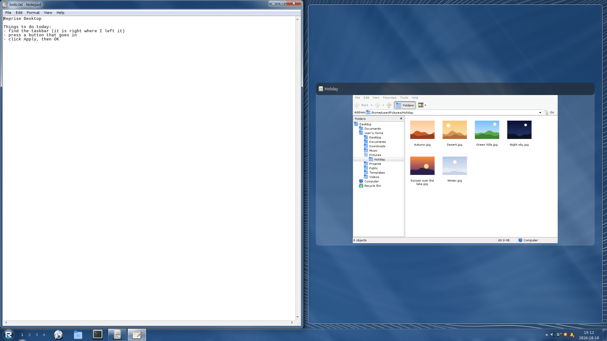

# Features

See [programs.md](programs.md) for bundled apps and [interfaces.md](interfaces.md) for Classic, Blue and Glass. Every default shortcut below can be rebound except the Super tap, `Super+Shift+Esc` and VT switches.

## Taskbar

Place the taskbar on any edge with `[taskbar] position` (or drag it while unlocked). Auto-hide collapses the bar to a 2 px line and reveals it on pointer hover, Start, `Alt+Tab` or an attention request. Four button modes cover icons only, labelled and grouped when full, never grouped, or kept side by side per app.

Pin programs to the task row or Quick Launch (overflowing behind `»` when narrow). Every monitor has a taskbar, and `[taskbar] per_monitor_buttons` restricts each bar to windows on that monitor. Drag buttons to reorder them, middle-click to launch another instance, or hover a dragged file for 0.5 s to raise the window.

With `[taskbar] pinned` on (Glass default), right-click a task button for its jump list (recent files, desktop actions, windows, Pin/Unpin, Move to desktop and Close), or `Shift+right-click` for the window menu. With `pinned` off, right-click opens the window menu directly. Hovering a task button shows live previews (with MPRIS controls for media players) and dims other windows on hover. Attention requests flash for 30 s (`[taskbar] attention_flash`), and `LauncherEntry` apps display progress bars and unread badges (`[taskbar] badges`).

The taskbar menu cascades or tiles windows, opens Task Manager (`Ctrl+Shift+Escape`) and locks the bar. Quiet tray icons hide behind an overflow arrow (configured via Customize...). Click the clock for a monthly calendar with `evolution-data-server` events (`[taskbar] calendar_events`), or double-click it to open Date and Time Properties.

Keyboard navigation: `Super+T` focuses Start, `Super+B` focuses the tray, `Super+1` to `Super+9` activate task buttons, `Super+D` shows the desktop, and holding `Super+,` previews the desktop (`[taskbar] peek`). Arrow keys navigate task buttons and live previews (`Enter` activates, `Delete` closes, `Escape` cancels).

## Start menu and launcher

Open Start with `Super`, `Ctrl+Esc` or the Start button. `startmenu_style` selects Classic, Blue or Glass menus in any interface. Settings > Start Menu edits the Classic menu and Quick Launch (`~/.config/reprise/quicklaunch/`), saving only diffs against defaults unless a full `[[startmenu]]` list overrides it. For the Blue and Glass menus it picks the places on the right, the power button's action, how many frequent programs show, and clears the recent items. Right-click the Start button to open `~/.local/share/applications` or Start Menu settings.

Installed programs appear immediately without restarting. Programs that share a name are listed once in the menus and search: Reprise's own, else the one whose desktop file id sorts first. Recent documents share `recently-used.xbel` with GTK apps (`[privacy] recent_files = false` disables them). Right-click any program in Start or the launcher for Open file location, Add to desktop or Uninstall... (Flatpak or PackageKit); a search for "uninstall" or "remove programs" offers a row that opens the program list. Browser-installed web apps prompt for confirmation and appear in All Programs. Run... executes commands or opens paths. A name typed from habit that is not installed starts the Reprise program for it: `calc`, `notepad`, `mspaint`, `charmap`, `taskmgr`, `explorer`, `control` (Settings) and `cmd` (the terminal), with or without `.exe`.

Press `Super+Space` (or type in the Glass Start menu) to search programs, settings pages, open windows and files. Typing maths (`2+3*4`) or unit conversions (`5 km in mi`) lets you press `Enter` to copy the result. File search uses `plocate` or `fd`. Enable `[launcher] contents` in Settings > Search to include `localsearch` content matches, and configure GNOME search providers there.

## Windows

Frames provide minimize, maximize, close, configurable caption double-click (`[windows] title_double_click`) and `Super+drag` move. Press `Alt+Space` or right-click a title bar for the window menu: Roll Up, Always on Top, Always Open Here, Mini View, Move to Desktop and tab actions. Always Open Here creates a window rule for the current screen, position and size. Mini View creates a small always-on-top live picture.

Drop one title bar onto another to group windows as tabs (`Super+\`` and `Super+Page Up`/`Page Down` cycle tabs). Shake a title bar to minimize other windows on that monitor (`[windows] shake`). Dim unfocused windows up to 40% (`[windows] dim_inactive`), cap hidden vsynced windows (`[windows] hidden_frame_rate`), and remember window positions per monitor set (`[windows] remember`). Configure these on Settings > Window Behavior.

Window rules (Settings > Window Rules) match by app ID and title to set size, position, screen, desktop, state or tab group. Picture-in-picture videos stay on top on every desktop unless a rule overrides them.

`Super+C` centres a window, `Super+Shift+B` toggles its frame, and `Esc` cancels a drag. Unresponsive windows trigger End Program when closed. Modal dialogs keep focus above their parent family, new windows do not steal focus ([security.md](security.md#focus)), and `[effects]` controls window and menu animations.

## Snapping

Drag a window to a side to fill half the screen, to the top to maximize, or into a corner for a quarter (`[window_snapping] distance`). Hover a maximize button, press `Super+Z`, or drag toward the top edge for snap layouts (customizable via `[window_snapping] layouts`) and recent screen arrangements.

After snapping, snap assist offers live thumbnails of other windows for empty zones. Drag the shared edge between snapped windows to resize both together. Use `Super+Arrow` keys to snap across zones and monitors, and `Super+Shift+Left`/`Right` to move a window proportionally to another monitor.

## Switching

`Alt+Tab` shows icons with a selected preview, or live thumbnails of all windows in four sizes, with media badges and active media keys. `Alt+\`` switches windows of the focused program only. Under Glass, `Super+Tab` opens the 3D switcher ([interfaces.md](interfaces.md#glass-only)).

`Super+W`, a hot corner (`[overview] hot_corner`) or a three-finger swipe up opens the window overview. Virtual desktops default to four (up to 16), switched with `Super+Ctrl+Left`/`Right` or the taskbar pager (`[workspaces]`).

## Desktop

The desktop shows Documents, Computer, Home, Recycle Bin and `~/Desktop` (`desktop_extensions`), sharing a `Ctrl+Z` undo history with Explorer. The New menu lists templates from `XDG_TEMPLATES_DIR` (`~/Templates`), and the context menu includes Open in Terminal (`terminal`). Enable clock, calendar and system meter widgets from the desktop menu or Settings > Background (`desktop_widgets`).

`.desktop` files on the desktop require Allow Launching before running, and executable files prompt on first run (`confirm_scripts`, `script_open`).

File dialogs remember folder, view, sort, size and position per app, update live, support band selection and keys (`F5`, `Ctrl+H`, `Alt+arrows`, `Ctrl+Shift+N`, `F2`, `Delete`), and share GTK bookmarks via Pin to Places.

Wallpapers support fill, fit, stretch, tile, centre, slideshows, per-desktop images, per-monitor images, water ripples and fluid styles (`ink`, `glow`, `sparks`, `neon`). Screen savers include Blank, Starfield, Mystify, Logo and Photos.

## Clipboard, emoji and screenshots

`Super+V` opens an in-memory history of the last 25 text and image copies, excluding password managers. The last copy persists after its app quits, and middle-click paste works.

`Super+.` opens an emoji picker at the caret (requires a colour emoji font). Colour emoji, including skin tones, ZWJ sequences, flags and keycaps, render across titles, menus and text fields. Path inputs complete inline, and Reprise text fields provide an Edit menu (`Shift+F10`, Menu key or right-click).

Screenshots save to the clipboard and optionally `Pictures/Screenshots` as PNG, JPG or JPEG XL (`[screenshot] format`), with an optional 0 to 10 s delay (`[screenshot] delay`):

- `PrtSc`: full screen
- `Alt+PrtSc`: focused window
- `Ctrl+Alt+PrtSc`: focused window content
- `Shift+PrtSc` or `Super+Shift+S`: interactive region or window

Click the saved screenshot notification to open it, or use Edit (Paint) and Show in Folder.

Press `Ctrl+Shift+Alt+R` to start or stop recording the screen under the pointer, or press `V` in the `Shift+PrtSc` picker to record a region. Recordings save as MP4 (H.264, H.265 or AV1) in `Videos/Screencasts` ([configuration.md](configuration.md#recording)). Settings > Screen Capture configures formats, codecs, audio capture and microphone mixing (`[screenshot] record_microphone`).

Press `Super+Shift+C` for a colour-picker loupe (`Enter` or click copies `#rrggbb`).

## Notifications

Notifications appear as balloons near the tray with action buttons, inline chat replies and preview images. A bell icon (`Super+Shift+N`) opens the session history grouped by app. Bursts of more than three balloons in 10 s collapse into a summary balloon.

Mute balloons or sounds per program in the history menu or Settings > Notifications. Do Not Disturb holds non-critical notifications manually, during `quiet_hours`, or during fullscreen windows and screen shares.

## Lock, power and session

The lock screen accepts your password or fingerprint (`[power] locker` sets an external locker with Reprise as fallback). Under `reprise-login`, the lock screen's power menu includes Switch User, Stand By, Restart and Turn Off. `[lock] media` controls the lock-screen now-playing strip (`"controls"` hides title/artist, `"off"` hides the strip). `[effects] logon_animation` toggles lock transitions on Blue and Glass.

Configure idle timeouts for screen saver, lock, screen off and suspend separately for AC and battery. The screen always locks before suspend. Set a Bluetooth phone in Settings > Screen Saver & Lock to lock when you walk away ([configuration.md](configuration.md#lock-when-away)).

Power features include lid and button actions, clamshell mode, battery alarms, automatic low-battery power saver (`[power] low_battery_saver`) and UPower battery charge limits (Power Options > Power Meter). In the Turn Off dialog, hold `Shift` to change Stand By to Hibernate.

Where `systemd-boot` exposes boot entries through logind, Restart Into... performs a one-shot reboot into another OS or Firmware Setup. If PackageKit has a prepared offline update (such as via `pkcon update --only-download`), the Turn Off dialog and Glass Shut down menu offer to install updates on shutdown or restart.

Log Off, Turn Off and Restart prompt for apps that block closing (including Inhibit portal holders) with End Now and Cancel. `[session] restore` reopens running apps on their desktops, snap groups and tab groups, restoring open Notepad files, Explorer tabs and the last Settings page. Manage XDG autostart on Settings > Startup and locale on Settings > Region & Language ([programs.md](programs.md#reprise-settings)). If Reprise panics, it restarts in place, stays locked if locked, and restores your session.

## Login screen

`reprise-login` is installed disabled ([install.md](install.md#use-the-login-manager)). `[login] interface` in `/etc/reprise/login.toml` chooses Classic, Blue or Glass, defaulting to the last session's interface ([configuration.md](configuration.md#login-manager)).

Features include user switching while locked sessions keep running, resuming an existing local or remote session on login ([remote-desktop.md](remote-desktop.md#remote-logins)), `Super+Alt+S` Orca screen reader support, Caps Lock and keyboard layout indicators, autologin (`[login] autologin_user`), and custom backgrounds and display layouts in Settings > Login Manager. Shut Down and Restart require an admin password when another user is logged in. If the login screen fails, it falls back to tty2.

## Displays

Configure multiple monitors (mode, fractional scale from 1 to 4 in 0.25 steps, rotation, position, ICC calibration via `[[outputs]] icc_profile`, and VRR `off`/`on`/`fullscreen`) in Settings > Display. Unconfirmed changes revert automatically.

Reprise saves layouts per connected monitor set and restores them on dock or undock. Press `Super+P` to switch between Extend, Duplicate, Only 1 and Only 2. Night light follows sunset/sunrise or a schedule and can be paused from the tray displays icon (which also adjusts brightness per display). Convertibles with `iio-sensor-proxy` support `[display] auto_rotate`. Explicit sync is enabled for drivers that need it.

## Input

Switch keyboard layouts with `Left Alt+Shift` or the tray icon, optionally per window (`[keyboard] layout_per_window`). Shortcuts use the first Latin layout when a non-Latin layout is active. Hold `Super` for one second to view the active shortcut sheet (`[shortcut_overlay]`).

Input methods (`fcitx5` and `ibus start --type wayland`), drag-and-drop text/paths into fields, three- or four-finger touchpad gestures (`[gestures]`), touchscreens, drawing tablets and pad mappings, GlobalShortcuts portal bindings, media keys and Caps/Num Lock OSDs (`[osd]`) are supported.

## Accessibility

Reprise's shell, menus, dialogs, lock/login screens and bundled apps expose AT-SPI (tested with Orca). Press `Super+Alt+S` anywhere, including lock and login screens, to toggle Orca.

Other tools: magnifier from 1x to 8x (`Super+=` and `Super+-`), colour blindness/grayscale/inverted filters (`Super+Ctrl+C`), text scaling from 125% to 200%, `[effects] reduce_motion`, StickyKeys (press `Shift` five times), SlowKeys (hold right `Shift` for 8 s), BounceKeys (`[accessibility] bounce_keys`), pointer locator (tap `Ctrl`, `[accessibility] locate_pointer`), visual bell (`[accessibility] visual_bell`), MouseKeys (`Left Alt+Left Shift+Num Lock`) and `Alt`-triggered access-key underlines.

## Hardware and network

Built on PipeWire, NetworkManager, BlueZ, UPower and systemd-logind:

- **Audio.** Tray volume mixer per app, Volume Control (balance, bass, treble) and XDG event sounds (`[sounds] events`).
- **Network.** Wi-Fi, wired, WireGuard, OpenVPN, hotspots, speed meter, airplane mode and manual/PAC proxy settings.
- **Bluetooth and phone.** Pairing, device batteries, file receive and KDE Connect tray integration (battery, ring, send files).
- **Storage.** Auto-mount (including encrypted drives), MTP/PTP portable devices, Thunderbolt/USB4 authorization, gvfs network shares (`smb://`, `\\server\share`), read-only `.iso`/`.img` mounting and [Disk Usage](programs.md#disk-usage).
- **Printers and software.** Driverless and queued CUPS printing, Software Updates (packages, Flatpaks, firmware) and double-click installation of `.flatpakref`, `.flatpak`, `.pkg.tar.zst` and `.deb` files.

## Privacy and security

The tray shows a red dot for screen sharing, recording or remote input, plus indicators for microphone, camera and location use (see [security.md](security.md#out-of-scope-and-known-gaps)). Settings > Privacy toggles the red capture border, location access (Reprise hosts the GeoClue2 agent), Flatpak clipboard access and remembered app permissions.

Screen sharing, remote control, location, camera and dynamic launcher prompts default to Cancel or Deny. Sandboxed apps cannot access privileged protocols ([security.md](security.md#sandboxed-programs)). A built-in polkit agent handles admin password and fingerprint prompts. Date and Time supports location-based automatic time zones ([programs.md](programs.md#date-and-time-properties)).

## Sharing and remote access

Screen sharing supports full screens or individual windows in browsers and OBS. Remote control tools require consent (showing a balloon when remembered). Deskflow keyboard/mouse sharing, VM shortcut capture and pointer lock/raw motion are supported. Press `Super+Shift+Esc` to reclaim input at any time. Flatpak email requests open your configured mail client.

Reprise also ships an integrated RDP server for single-user sessions and multi-user remote logins under `reprise-login` ([remote-desktop.md](remote-desktop.md)).

## Files

[Explorer](programs.md#explorer) offers five views, thumbnails, live folders, background copies, undo, freedesktop trash, Send To and drag-and-drop. Sandboxed apps use Reprise's Open, Save and Open With dialogs, and browser "Show in folder" selects files in Explorer. Unresponsive mounts time out operations after 15 s without freezing the UI.

## Configuration

First login runs [Welcome](programs.md#welcome) and optional [Import from another desktop](programs.md#import-from-another-desktop) (GNOME or Plasma). `config.toml` reloads live ([configuration.md](configuration.md#if-the-file-has-an-error)), Reprise Settings preserves comments, shortcuts (including modifier-only chords) are rebindable, and third-party tools work via standard protocols ([protocols.md](protocols.md)). Enable `[debug] overlay` for frame times, damage and memory stats. Main-loop stalls log traces to the journal without blocking monitor commits.

## Not yet

- Only one GPU renders and drives displays (`[display] all_gpus = true` tracks other GPUs' monitors without lighting them), and there are no DRM leases for VR headsets.
- No HDR or colour management.
- X11 programs render at scale 1 and scale up on HiDPI displays.
- No help viewer (`?` buttons are inert).
