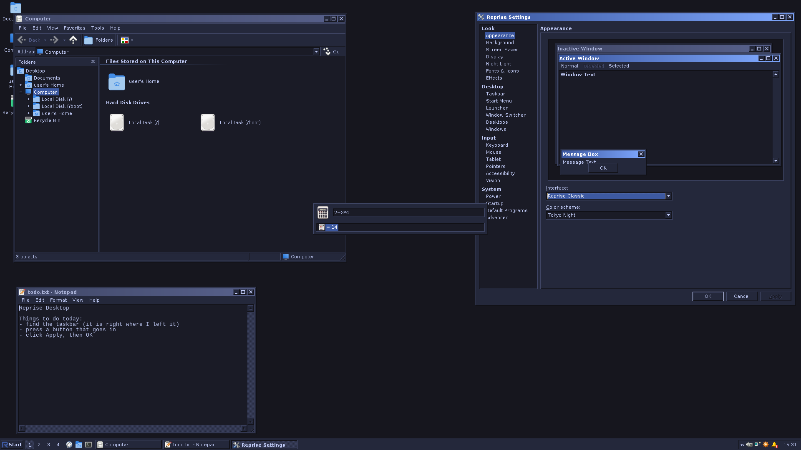
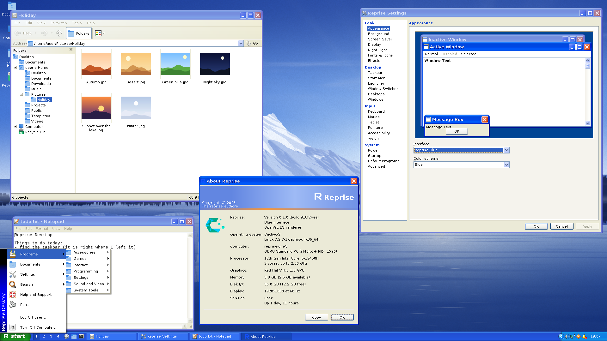
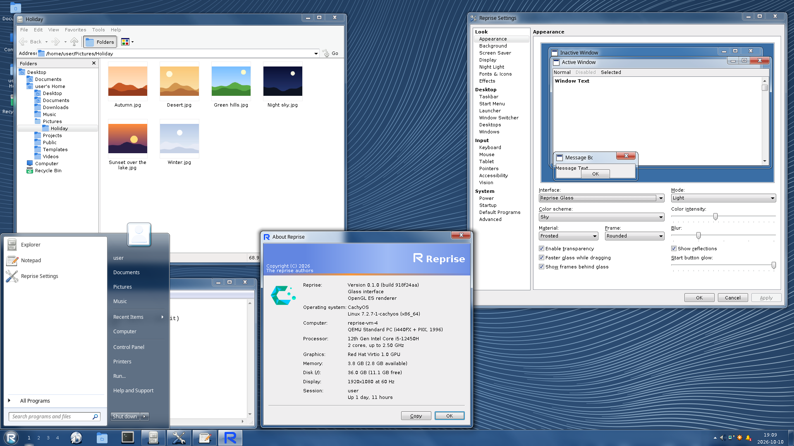
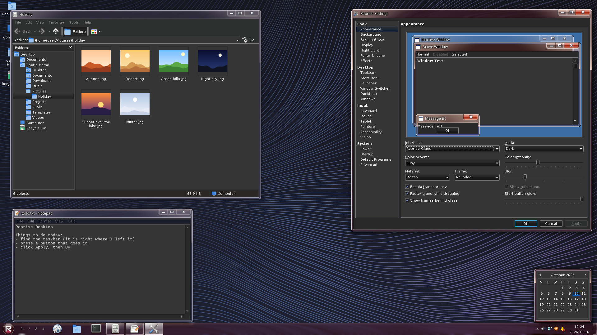
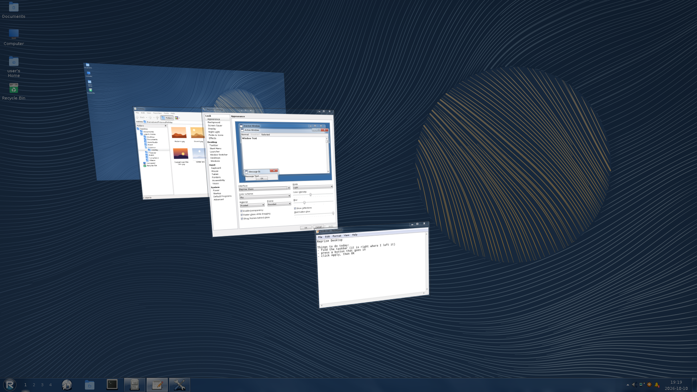

# Interfaces

Reprise has three looks. `[appearance] interface` picks one: `"classic"`
(the default), `"blue"` or `"glass"`. The Appearance page of Reprise Settings
sets the same key, and the switch happens live. Your windows stay where they
are; only their clothes change.

Each interface brings its own window frames, taskbar, controls, menus and
popups. Reprise's own programs follow along, property sheets included. Dialog
layouts and sizes are the same in all three, so a sheet you learned under
Classic has its buttons in the same places under Glass.

## Reprise Classic

Grey bevelled frames with a gradient caption, a 28 px grey taskbar and the
cascading Start menu with a band down its side. No shadows, no glass, no
nonsense.

Colour schemes (`[appearance] color_scheme`):

- **Reprise Standard** (the default): navy fading to sky blue on a warm grey
  face.
- **Reprise Classic**: the older, cooler grey with a navy-to-blue caption.
- **Period schemes**: Brick, Desert, Eggplant, Lilac, Maple, Marine, Plum,
  Pumpkin, Rainy Day, "Red, White, and Blue", Rose, Slate, Spruce, Storm,
  Teal and Wheat.
- **High contrast**: High Contrast #1, High Contrast #2, High Contrast Black
  and High Contrast White. These also tell programs to raise their contrast.
- **Dark schemes**: Ayu Dark, Catppuccin Mocha, Dracula, GitHub Dark, Gruvbox
  Dark, Monokai, Night Owl, Nord, One Dark and Tokyo Night. They tell GTK, Qt
  and browser programs to go dark too.

`[colors]` overrides any single colour of the scheme, and `[metrics]` any
size: frame width, caption height, taskbar height and so on. Both work under
every interface.

## Reprise Blue

Glossy skinned frames with a 26 px caption, a bold white title with a drop
shadow, and square caption buttons with a little gap between them. The
taskbar is a 30 px gradient with a rounded "start" button, rounded task
buttons and a recessed notification area. Buttons, check boxes, scrollbars,
tabs, trackbars and the rest have their own Blue art.

The Start menu keeps the Classic layout and band, in Blue's flat menus; the
band takes its colours from the scheme.

Colour schemes: **Blue** (the default), Olive Green, Silver, Slate, Sapphire,
Obsidian, Ember, Cobalt, Carbon and Steel. Each brings its own art. None of
them is dark; Blue is a daytime look.

Blue's defaults match Classic's, except that the lock screen shows your
wallpaper.

The caption title wants Trebuchet MS and the Start button Franklin Gothic
Medium. Reprise doesn't ship either; see [assets.md](assets.md#fonts).

## Reprise Glass

Translucent frames over a live blur of what's behind them, with rounded
corners, reflection streaks and soft window shadows. The taskbar is a 40 px
glass bar with a Start orb, icon-only task buttons, a two-line clock and a
Show desktop strip at the end. Task buttons glow in their icon's colour when
you point at them.

Glass is more than the frames. The Start menu, Alt+Tab, the window overview,
snap layouts, the launcher, the calendar, notification history, the volume
panel, clipboard history, the emoji picker and the tray's hidden icons are all
glass too.

The blur runs on the GPU, only when something near the glass changes, and
only over the part that changed. A still desktop does no blur work at all.
Typing in the middle of a window doesn't either. At output scale 2 and
up it blurs a quarter-resolution copy of the desktop: the same spread for
a quarter of the work.

### Colour and material

Glass has no colour schemes. It has a `[glass]` section instead:

| Key | Values | Default |
| --- | --- | --- |
| `color` | `sky`, `twilight`, `sea`, `leaf`, `lime`, `sun`, `pumpkin`, `ruby`, `fuchsia`, `blush`, `violet`, `lavender`, `taupe`, `chocolate`, `slate`, `frost`, or `"#RRGGBB"` | `sky` |
| `intensity` | how much of the colour shows, 0 to 100 | 42 |
| `mode` | `light` or `dark` | `light` |
| `material` | `frosted`, `smoked` or `molten` | `frosted` |
| `frame` | `rounded` or `square` | `rounded` |
| `notification_style` | the notification sheet's shape: `lozenge`, or `halo` with the app icon breaking out of its top-left edge and the glass washed in the icon's colour | `lozenge` |
| `transparency` | `false` draws the glass opaque and turns the blur off | `true` |
| `blur` | strength, 1 (least GPU work) to 5 | 2 |
| `streaks` | the diagonal reflections on Frosted glass | `true` |
| `fast_drag` | a cheaper blur while a window is dragged or sized; at output scale 2 and up the blur is always this one | `true` |
| `blur_frames` | glass over another window's frame and glass, a dialog's or the taskbar's shows them blurred; `false` saves a blur per such piece of glass | `true` |
| `blur_rate` | at most this many re-blurs a second of a busy program next to the glass or of desktop water, `0` for every frame | 30 |
| `orb_glow` | how strongly the Start button's icon glows, 0 (none) to 100 | 100 |

- **Dark mode** turns controls, dialogs, menus and titles dark and tells
  programs to go dark through the portal. The glass keeps its colour.
- **Smoked** glass lets less through, with white titles in either mode.
- **Molten** glass blurs less, shows richer colours and bends what lies just
  past its edges, with a faint colour fringe and a light catching its rims.
- **Square** frames have square corners, a centred title and flat, separate
  caption buttons.

The Appearance page of Reprise Settings sets all of these but `blur_rate`.

Window titles want Segoe UI; without it they fall back to Noto Sans, then
DejaVu Sans.

### The Start menu

Glass opens a two-column Start menu. The left side has pinned and frequent
programs, All Programs and a search box that finds programs, settings pages
and files, and does sums. The right side has your home folder, Documents,
Pictures, Music, Recent Items, Computer, Control Panel, Printers and Run.
Hover a program for its jump list. The Shut down button turns the computer
off, and the arrow next to it offers Log off, Lock, Restart, Sleep and
Hibernate.

### Glass only

- **The 3D switcher.** Super+Tab tilts every window into a stack over the
  dimmed desktop. Tab or the wheel rolls it, releasing Super switches, a click
  picks a card, Esc backs out. `[switcher] flip = false` turns it off, and
  Super+Tab acts like Alt+Tab.

  

- **Small icons.** `[taskbar] small_icons` shrinks the bar to 30 px.
- **Pager marks.** `[workspaces] pager = "light"` or `"tile"` marks the
  current desktop with a light under its number or a tile behind it.

## Defaults by interface

A key you leave out follows the interface, so switching interface switches
every default you haven't set.

| Key | Classic and Blue | Glass |
| --- | --- | --- |
| `[taskbar] buttons` | `when_full` | `combine` |
| `[taskbar] pinned`, `show_desktop_button`, `peek` | off | on |
| `startmenu_style` | `classic` | `glass` |
| `[switcher] style` | `icons` | `thumbnails` |
| `[switcher] desktop`, `peek`, `flip` | off | on |
| `[effects] window_animation`, `hover_fade`, `taskbar_slide` | off | on |
| `[wallpaper] lock_screen` | Classic off, Blue on | on |

Most of what Glass turns on, the other looks can have too. Set the key and
Classic gets pinned programs, jump lists, Peek, a Show desktop strip,
thumbnails in Alt+Tab, window animations, or the two-column Start menu
(`startmenu_style = "glass"`, drawn as opaque glass). It works the other way
as well: Glass can have the Classic Start menu and labelled task buttons.

Tray overflow, auto-hide, taskbar position, live previews, the overview,
snapping, virtual desktops, the wallpaper, water and the screen savers work
the same under every interface.
