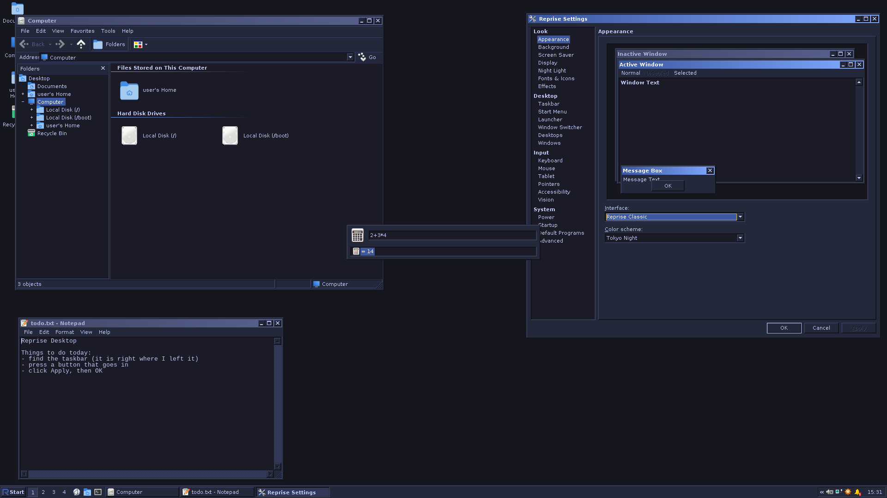
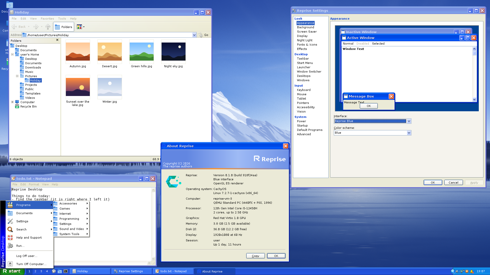
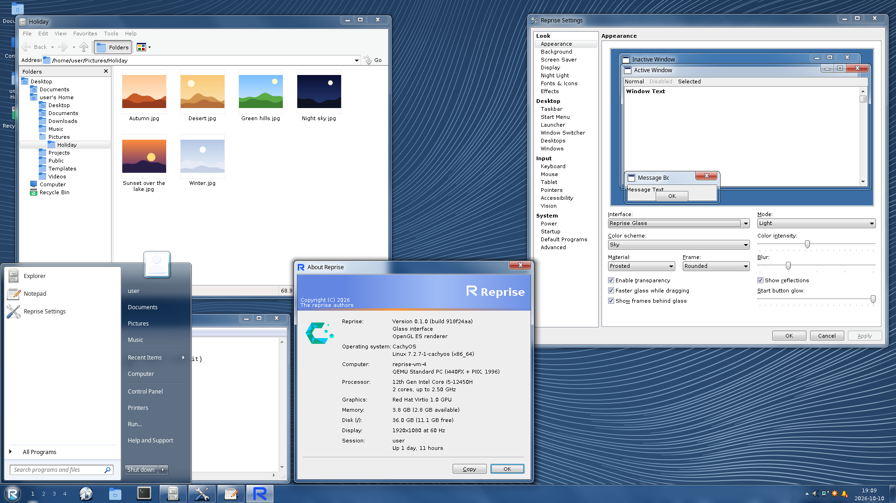
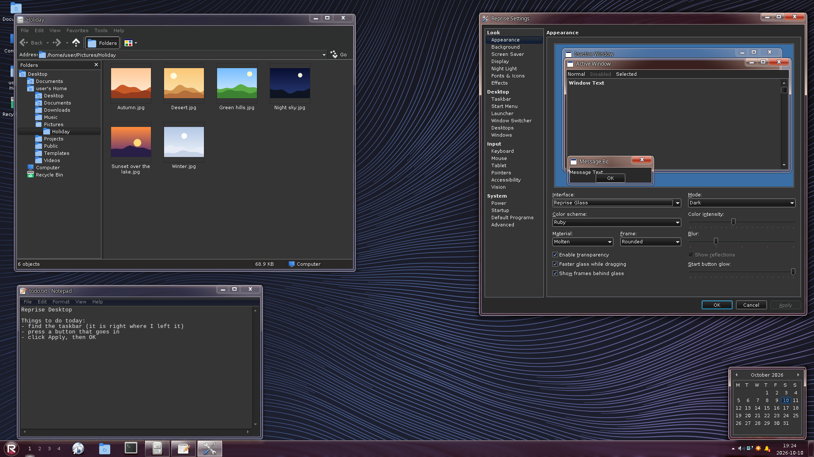
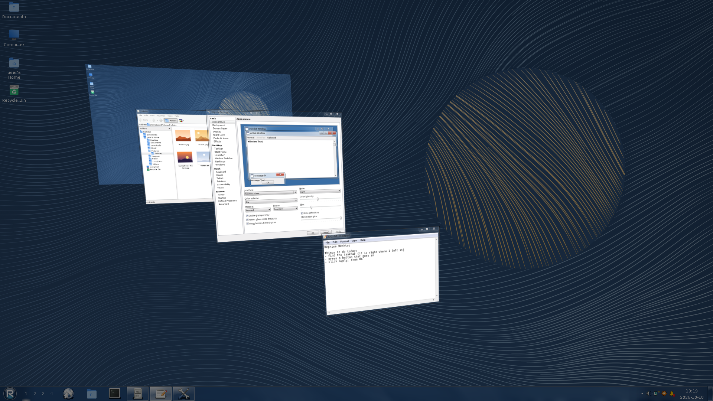

# Interfaces

Set `[appearance] interface` to `"classic"` (default), `"blue"` or `"glass"`, or switch live in Settings > Appearance. Window frames, the taskbar, controls, menus, popups and bundled programs update together while keeping the same dialog layouts.

## Reprise Classic

Grey bevelled frames, a gradient title bar, a 28 px grey taskbar and a cascading Start menu.

Choose a palette with `[appearance] color_scheme`:

- Default: Reprise Standard (warm grey, navy-to-sky caption) and Reprise Classic (cooler grey).
- Period: Brick, Desert, Eggplant, Lilac, Maple, Marine, Plum, Pumpkin, Rainy Day, "Red, White, and Blue", Rose, Slate, Spruce, Storm, Teal and Wheat.
- High contrast: High Contrast #1, High Contrast #2, High Contrast Black and High Contrast White (signals apps to raise contrast).
- Dark: Ayu Dark, Catppuccin Mocha, Dracula, GitHub Dark, Gruvbox Dark, Monokai, Night Owl, Nord, One Dark and Tokyo Night (signals GTK, Qt and browsers to use dark mode).

`[colors]` overrides individual colours and `[metrics]` overrides sizes across all interfaces. The lock screen shows the Unlock Reprise dialog (with Switch User under `reprise-login`).

## Reprise Blue

Glossy frames with a 26 px caption, bold shadowed white titles, a 30 px gradient taskbar with a rounded "start" button, and Blue controls.

Blue's two-column Start menu shows your user picture at the top, pinned/frequent apps and All Programs on the left, folders and system items on the right, and Log Off / Turn Off Computer at the bottom. Type a letter to jump to a row. The lock screen shows your user tile open for a password.

Blue has ten light schemes: Blue (default), Olive Green, Silver, Slate, Sapphire, Obsidian, Ember, Cobalt, Carbon and Steel.

Caption titles use Trebuchet MS and the Start button uses Franklin Gothic Medium ([assets.md](assets.md#fonts)).

## Reprise Glass

Translucent frames over a live GPU blur, rounded corners, reflection streaks and soft shadows. The 40 px taskbar has a Start orb, icon-only task buttons that glow in their icon's colour on hover, a two-line clock and a Show desktop strip.

Glass also styles the Start menu, Alt+Tab, window overview, snap layouts, launcher, calendar, notification history, volume panel, clipboard history, emoji picker and tray overflow. Blur updates only when pixels behind glass change. The lock screen shows your user tile marked Locked over your wallpaper.

### Colour and material

Glass uses `[glass]` instead of colour schemes (see `config.example.toml`). Configure it on Settings > Appearance (except `blur_rate`), `orb_glow` on Taskbar, and `notification_style` on Notifications.

- Dark mode switches controls, dialogs, menus, titles and the portal to dark. Scheduled `night` or `hours` modes switch automatically, and picking Light or Dark ends the schedule.
- Disabling transparency uses opaque frames and taskbar (black taskbar labels in light mode, white in Smoked or dark mode).
- Smoked glass reduces transparency and uses white titles.
- Molten glass blurs less, boosts colour and refracts edges.
- Square frames use square corners, centred titles and flat caption buttons.

Window titles use Segoe UI, falling back to Noto Sans then DejaVu Sans.

### The Start menu

Glass opens a two-column Start menu with pinned/frequent apps, All Programs and search (apps, settings, files, maths, unit conversions) on the left, and folders and system shortcuts on the right. Hover a program or click its arrow for its jump list.

The Shut down arrow lists Log off, Lock, Restart, Restart into (if logind provides boot entries), Sleep and Hibernate, with Switch user first under `reprise-login`. Remote sessions show Disconnect first and omit Sleep and Hibernate ([remote-desktop.md](remote-desktop.md#disconnecting)). Prepared offline updates appear at the top ([features.md](features.md#lock-power-and-session)).

### Glass only

`Super+Tab` opens the 3D switcher on the screen under the pointer. Roll with Tab or the mouse wheel, release Super or click to switch, or press Esc to cancel. Set `[switcher] flip = false` to make `Super+Tab` behave like `Alt+Tab`.

`[taskbar] small_icons` shrinks the taskbar to 30 px. `[workspaces] pager = "light"` or `"tile"` highlights the active desktop.

## Defaults by interface

Unset keys follow the active interface when you switch.

| Key | Classic and Blue | Glass |
| --- | --- | --- |
| `[taskbar] buttons` | `when_full` | `combine` |
| `[taskbar] pinned`, `show_desktop_button`, `peek` | off | on |
| `startmenu_style` | `classic` / `blue` | `glass` |
| `[switcher] style` | `icons` | `thumbnails` |
| `[switcher] desktop`, `peek`, `flip` | off | on |
| `[effects] window_animation`, `hover_fade`, `taskbar_slide` | off | on |
| `[windows] shake` | off | on |
| `[wallpaper] image` | none / `reprise:tarn/blue` | `reprise:flow/glass` |

You can override any default across interfaces, including `startmenu_style = "classic"`, `"blue"` or `"glass"`. Tray overflow, auto-hide, taskbar position, live previews, overview, snapping, virtual desktops, wallpapers, water and screen savers work identically in all three interfaces.
