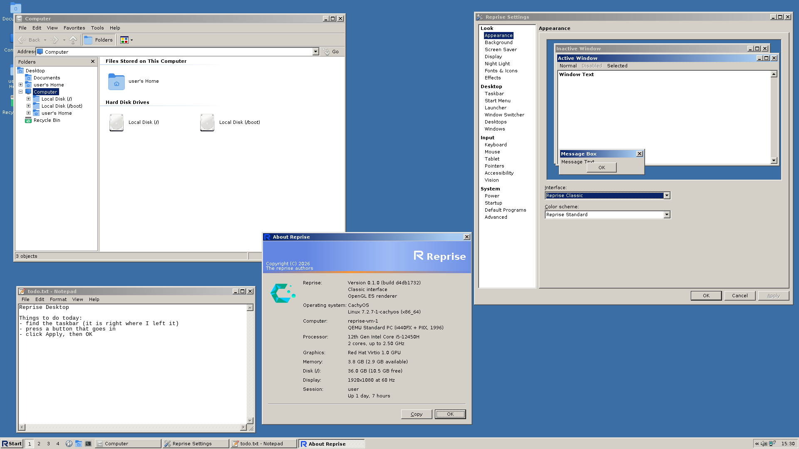
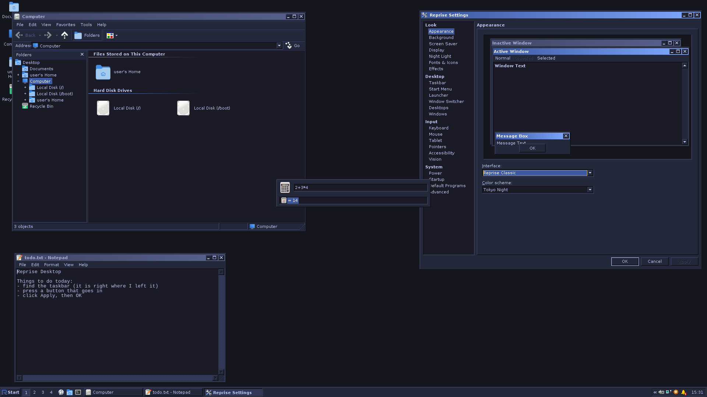
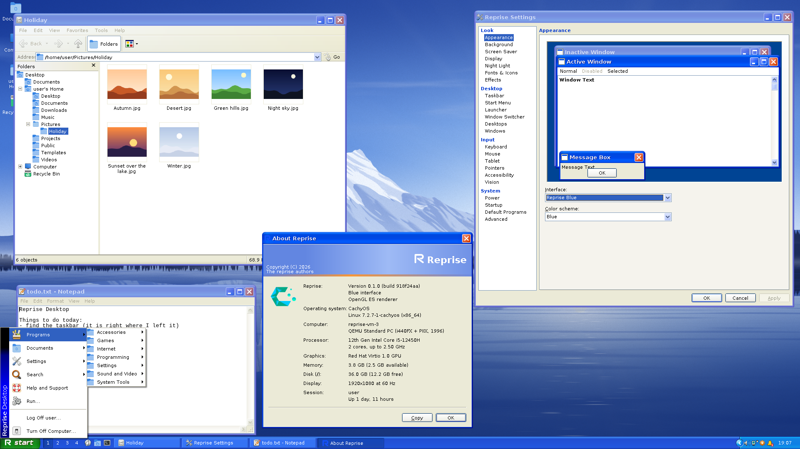
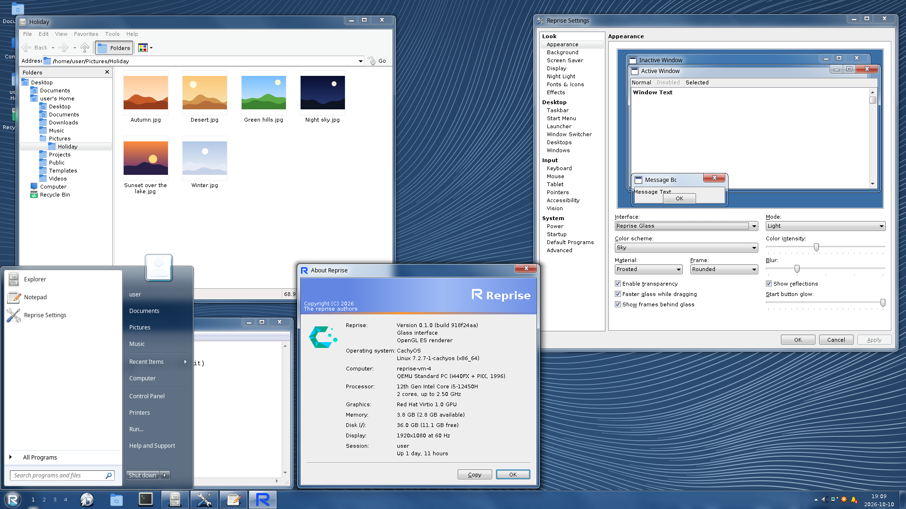
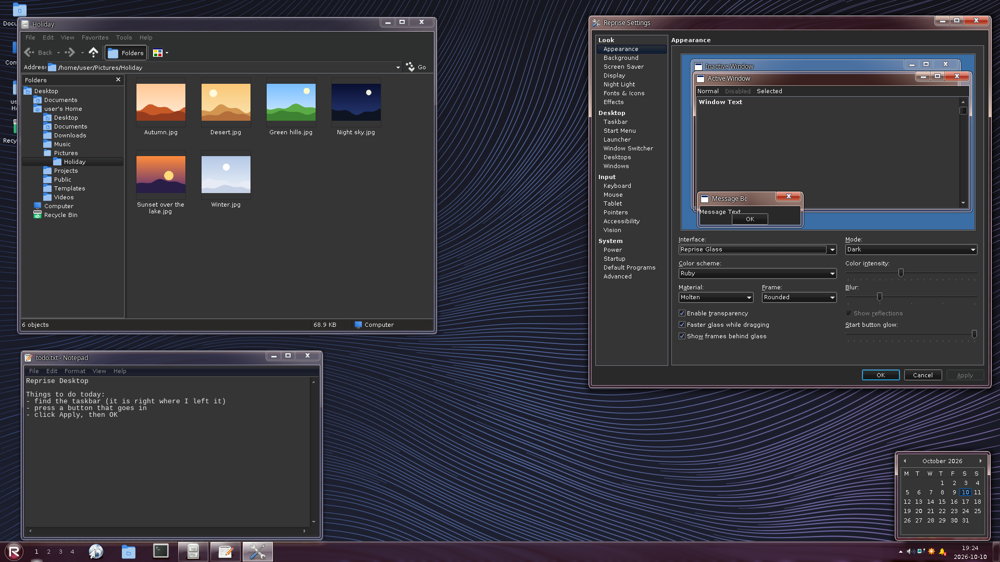
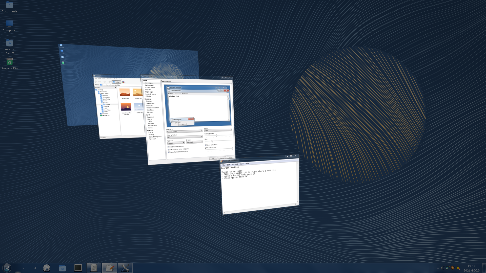
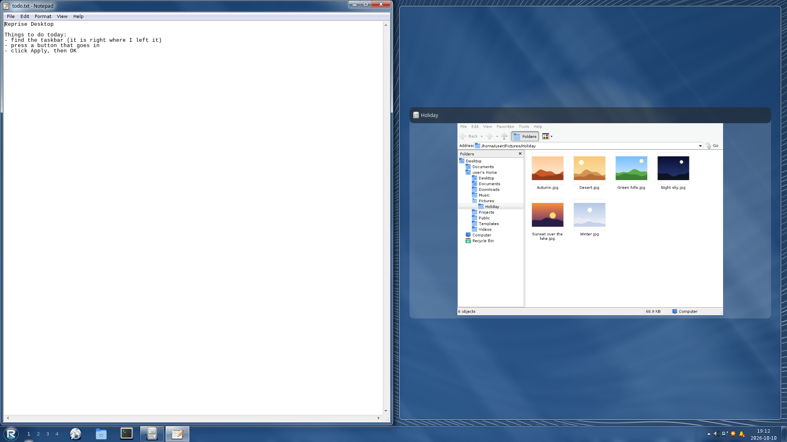

# Showcase

All screenshots show a stock install with default settings, background, fonts and icons.

## Reprise Classic

Reprise Standard scheme.

Tokyo Night dark scheme with the `Super+Space` launcher (`Enter` copies `14`).

## Reprise Blue

## Reprise Glass

Default light look and two-column Start menu.

Dark mode in Ruby with the Molten material and taskbar calendar.

## The 3D switcher

`Super+Tab` under Glass tilts open windows into a stack.

## Snap assist

Snap a window to an edge to pick another window for the free half.

See [interfaces.md](interfaces.md) and [features.md](features.md).
