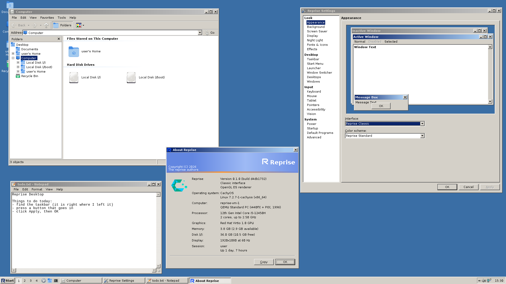

# Showcase

Every picture is a stock install: the default config and background, no
extra icon theme, no extra fonts. The holiday pictures are made up for the
occasion.

## Reprise Classic

Grey bevels, navy title bars and buttons that go in. Computer, Notepad,
Reprise Settings and About Reprise in the default Reprise Standard scheme.

The same desktop in Tokyo Night, one of ten dark schemes. Super+Space
opened the launcher, which does sums: Enter copies the 14.

## Reprise Blue

Glossy caption buttons, a rounded Start button and a gradient taskbar.
Explorer shows thumbnails, the Start menu is open on Programs.

## Reprise Glass

Translucent frames over a blur of the desktop, and the two-column Start
menu.

Dark mode, in Ruby, with the Molten material bending the light at the glass
edges. The clock opened the calendar.

## The 3D switcher

Super+Tab under Glass tilts every window into a stack, the desktop last.

## Snap assist

Notepad was dragged to the left edge and snapped to that half. The free
half offers the other windows, live.

More on each look in [interfaces.md](interfaces.md), and on everything else
in [features.md](features.md).
